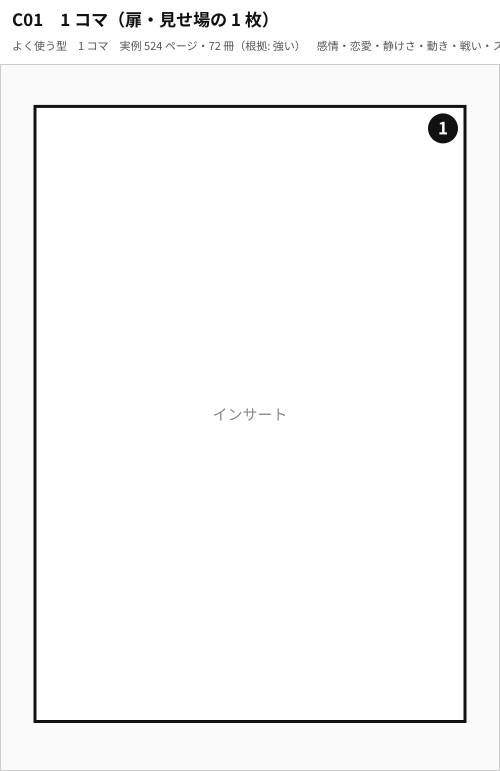

# C01 1 コマ（扉・見せ場の 1 枚）



- 種類: よく使う型、1 コマ
- 根拠: 実例 524 ページ・72 冊（強さ: 強い、全ページの 3.4%、最多の 1 冊が占める割合 5%）
- 向く場面: 感情・恋愛・静けさ（目的から）、動き・戦い・スポーツ（目的から）

## 目的

1 枚で見せる。扉、章の頭、話の最大の見せ場。4 枚に 1 枚は人物のいない情景で、無言が多い。

## 実際の漫画での使われ方

- 扉・章の頭の場面で多い（3.7 倍、24 冊）
- 単行本の終わり 1 割で多い（14%、全体 8%）
- 場面の頭に向く（1 コマ目が引きか人物なしのページが 39%、全体 28%）
- 女性漫画で多い（1.5 倍、107 ページ・9 冊）
- 1 ページの台詞は平均 1.57（全体 7.7）

## コマごとの中身（読む順）

1. **インサート**（`insert`）: 人物なし（物・景色・手元）が全体より多い（25%、全体の 1.4 倍）、無言が全体より多い（35%、全体 23%）

## 避けるとき

会話の途中。続けて使うと間延びする。次のページは多コマに戻す。

## ネーム TOML の雛形

```toml
[[pages]]
number = 1
# 型 C01: 1 コマ（扉・見せ場の 1 枚）
splash = true

  [[pages.panels]]
  tier = 0
  # 役割の目安: 人物なし（物・景色・手元）が全体より多い（25%、全体の 1.4 倍）、無言が全体より多い（35%、全体 23%）
  # shot = "insert"   # 目安: このコマで全体より多い shot（いちばん多いとは限らない）。場面に合わせて決める
  beat = ""
```
