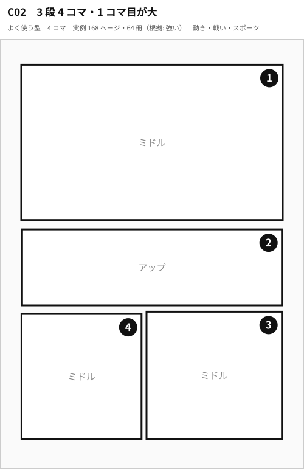

# C02 3 段 4 コマ・1 コマ目が大



- 種類: よく使う型、4 コマ
- 根拠: 実例 168 ページ・64 冊（強さ: 強い、全ページの 1.1%、最多の 1 冊が占める割合 7%）
- 向く場面: 動き・戦い・スポーツ（観測）

## 目的

上の大ゴマで出来事を見せ、細い横長の帯で顔の寄りを受け、下の 2 コマで続きを運ぶ。

## 実際の漫画での使われ方

- 動き・戦い・スポーツの場面で多い（1.5 倍、14 冊）
- 扉・章の頭の場面でやや多い（1.4 倍、ただし 5 冊だけ）
- 右ページ（めくった先）で多い（61%）
- 1 ページの台詞は平均 7.05（全体 7.7）

## コマごとの中身（読む順）

1. **ミドル**（`medium`）: 腰から上がいちばん多い（30%）
2. **アップ**（`closeup`）: 顔の寄りが全体より多い（33%、全体の 2.2 倍）
3. **ミドル**（`medium`）: 腰から上がいちばん多い（34%）
4. **ミドル**（`medium`）: 腰から上がいちばん多い（36%）

## 避けるとき

大ゴマの後に長い会話が続くページ（下の 2 コマでは運べない）。

## ネーム TOML の雛形

```toml
[[pages]]
number = 1
# 型 C02: 3 段 4 コマ・1 コマ目が大
tiers = [0.43, 0.21, 0.35]

  [[pages.panels]]   # 1
  tier = 0
  # 役割の目安: 腰から上がいちばん多い（30%）
  # shot = "medium"   # 目安: このコマでいちばん多い shot。場面に合わせて決める
  beat = ""

  [[pages.panels]]   # 2
  tier = 1
  # 役割の目安: 顔の寄りが全体より多い（33%、全体の 2.2 倍）
  # shot = "closeup"   # 目安: このコマで全体より多い shot（いちばん多いとは限らない）。場面に合わせて決める
  beat = ""

  [[pages.panels]]   # 3
  tier = 2
  width = 0.53
  # 役割の目安: 腰から上がいちばん多い（34%）
  # shot = "medium"   # 目安: このコマでいちばん多い shot。場面に合わせて決める
  beat = ""

  [[pages.panels]]   # 4
  tier = 2
  width = 0.47
  # 役割の目安: 腰から上がいちばん多い（36%）
  # shot = "medium"   # 目安: このコマでいちばん多い shot。場面に合わせて決める
  beat = ""
```
