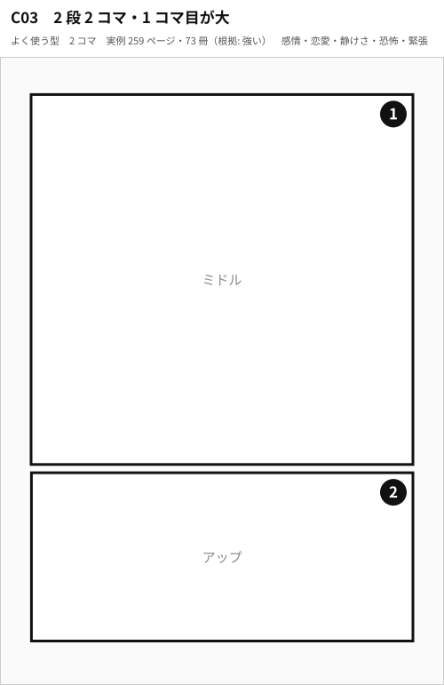

# C03 2 段 2 コマ・1 コマ目が大



- 種類: よく使う型、2 コマ
- 根拠: 実例 259 ページ・73 冊（強さ: 強い、全ページの 1.7%、最多の 1 冊が占める割合 6%）
- 向く場面: 感情・恋愛・静けさ（観測）、恐怖・緊張（観測）

## 目的

大ゴマ 1 枚と、それを受ける 1 コマ。上は無言が多く、下のコマは顔の寄りが多い。

## 実際の漫画での使われ方

- 扉・章の頭の場面で多い（1.5 倍、8 冊）
- 感情・恋愛・静けさの場面で多い（1.3 倍、23 冊）
- 恐怖・緊張の場面で多い（1.3 倍、16 冊）
- 単行本の終わり 1 割で多い（13%、全体 8%）
- 1 ページの台詞は平均 3.05（全体 7.7）

## コマごとの中身（読む順）

1. **ミドル**（`medium`）: 腰から上がいちばん多い（34%）、無言が全体より多い（35%、全体 23%）
2. **アップ**（`closeup`）: 顔の寄りが全体より多い（31%、全体の 2.0 倍）

## 避けるとき

台詞の多い会話。2 コマでは情報を運べない。

## ネーム TOML の雛形

```toml
[[pages]]
number = 1
# 型 C03: 2 段 2 コマ・1 コマ目が大
tiers = [0.69, 0.31]

  [[pages.panels]]   # 1
  tier = 0
  # 役割の目安: 腰から上がいちばん多い（34%）、無言が全体より多い（35%、全体 23%）
  # shot = "medium"   # 目安: このコマでいちばん多い shot。場面に合わせて決める
  beat = ""

  [[pages.panels]]   # 2
  tier = 1
  # 役割の目安: 顔の寄りが全体より多い（31%、全体の 2.0 倍）
  # shot = "closeup"   # 目安: このコマで全体より多い shot（いちばん多いとは限らない）。場面に合わせて決める
  beat = ""
```
