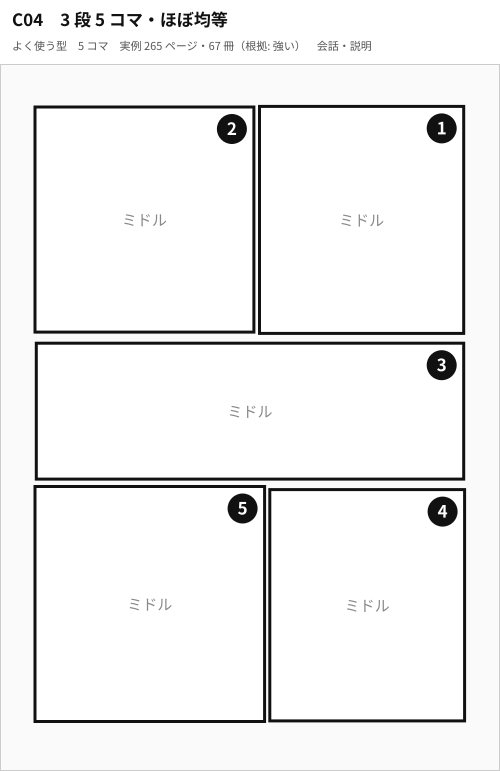

# C04 3 段 5 コマ・ほぼ均等



- 種類: よく使う型、5 コマ
- 根拠: 実例 265 ページ・67 冊（強さ: 強い、全ページの 1.7%、最多の 1 冊が占める割合 7%）
- 向く場面: 会話・説明（目的から）

## 目的

会話の標準形。5 コマとも腰から上が中心。上下の段で左右の境をずらし、中段の横長でつなぐ。

## 実際の漫画での使われ方

- 1 ページの台詞は平均 7.74（全体 7.7）

## コマごとの中身（読む順）

1. **ミドル**（`medium`）: 腰から上がいちばん多い（36%）
2. **ミドル**（`medium`）: 腰から上がいちばん多い（37%）
3. **ミドル**（`medium`）: 腰から上がいちばん多い（35%）
4. **ミドル**（`medium`）: 腰から上がいちばん多い（33%）
5. **ミドル**（`medium`）: 腰から上がいちばん多い（36%）

## 避けるとき

山場。均等に近く、どのコマも主役にならない。

## ネーム TOML の雛形

```toml
[[pages]]
number = 1
# 型 C04: 3 段 5 コマ・ほぼ均等
tiers = [0.38, 0.23, 0.39]

  [[pages.panels]]   # 1
  tier = 0
  width = 0.48
  # 役割の目安: 腰から上がいちばん多い（36%）
  # shot = "medium"   # 目安: このコマでいちばん多い shot。場面に合わせて決める
  beat = ""

  [[pages.panels]]   # 2
  tier = 0
  width = 0.52
  # 役割の目安: 腰から上がいちばん多い（37%）
  # shot = "medium"   # 目安: このコマでいちばん多い shot。場面に合わせて決める
  beat = ""

  [[pages.panels]]   # 3
  tier = 1
  # 役割の目安: 腰から上がいちばん多い（35%）
  # shot = "medium"   # 目安: このコマでいちばん多い shot。場面に合わせて決める
  beat = ""

  [[pages.panels]]   # 4
  tier = 2
  width = 0.46
  # 役割の目安: 腰から上がいちばん多い（33%）
  # shot = "medium"   # 目安: このコマでいちばん多い shot。場面に合わせて決める
  beat = ""

  [[pages.panels]]   # 5
  tier = 2
  width = 0.54
  # 役割の目安: 腰から上がいちばん多い（36%）
  # shot = "medium"   # 目安: このコマでいちばん多い shot。場面に合わせて決める
  beat = ""
```
