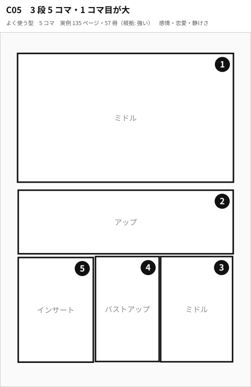

# C05 3 段 5 コマ・1 コマ目が大



- 種類: よく使う型、5 コマ
- 根拠: 実例 135 ページ・57 冊（強さ: 強い、全ページの 0.9%、最多の 1 冊が占める割合 8%）
- 向く場面: 感情・恋愛・静けさ（目的から）

## 目的

大ゴマで出来事、帯で顔の寄り、下の 3 コマで一人の表情と物の寄りを速く見せる。

## 実際の漫画での使われ方

- 1 ページの台詞は平均 7.38（全体 7.7）

## コマごとの中身（読む順）

1. **ミドル**（`medium`）: 腰から上がいちばん多い（33%）
2. **アップ**（`closeup`）: 顔の寄りが全体より多い（32%、全体の 2.1 倍）
3. **ミドル**（`medium`）: 腰から上がいちばん多い（36%）
4. **バストアップ**（`bust`）: 胸から上が全体より多い（32%、全体の 1.4 倍）、一人が多い（61%）
5. **インサート**（`insert`）: 人物なし（物・景色・手元）が全体より多い（28%、全体の 1.6 倍）

## 避けるとき

場所を見せたい場面の頭（大ゴマが出来事の寄りになりがち）。

## ネーム TOML の雛形

```toml
[[pages]]
number = 1
# 型 C05: 3 段 5 コマ・1 コマ目が大
tiers = [0.43, 0.21, 0.35]

  [[pages.panels]]   # 1
  tier = 0
  # 役割の目安: 腰から上がいちばん多い（33%）
  # shot = "medium"   # 目安: このコマでいちばん多い shot。場面に合わせて決める
  beat = ""

  [[pages.panels]]   # 2
  tier = 1
  # 役割の目安: 顔の寄りが全体より多い（32%、全体の 2.1 倍）
  # shot = "closeup"   # 目安: このコマで全体より多い shot（いちばん多いとは限らない）。場面に合わせて決める
  beat = ""

  [[pages.panels]]   # 3
  tier = 2
  width = 0.34
  # 役割の目安: 腰から上がいちばん多い（36%）
  # shot = "medium"   # 目安: このコマでいちばん多い shot。場面に合わせて決める
  beat = ""

  [[pages.panels]]   # 4
  tier = 2
  width = 0.30
  # 役割の目安: 胸から上が全体より多い（32%、全体の 1.4 倍）、一人が多い（61%）
  # shot = "bust"   # 目安: このコマで全体より多い shot（いちばん多いとは限らない）。場面に合わせて決める
  beat = ""

  [[pages.panels]]   # 5
  tier = 2
  width = 0.36
  # 役割の目安: 人物なし（物・景色・手元）が全体より多い（28%、全体の 1.6 倍）
  # shot = "insert"   # 目安: このコマで全体より多い shot（いちばん多いとは限らない）。場面に合わせて決める
  beat = ""
```
