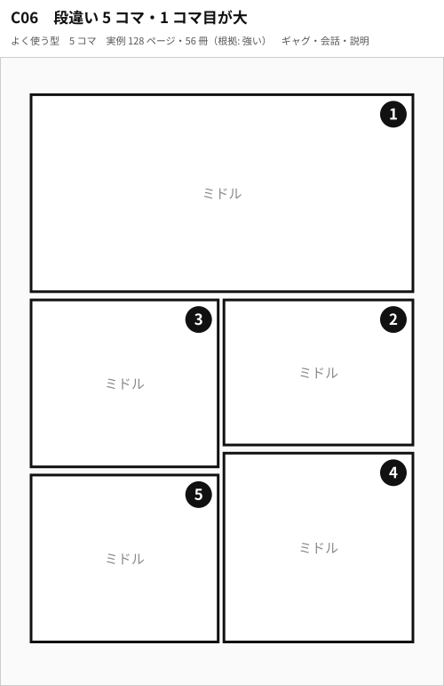

# C06 段違い 5 コマ・1 コマ目が大



- 種類: よく使う型、5 コマ
- 根拠: 実例 128 ページ・56 冊（強さ: 強い、全ページの 0.8%、最多の 1 冊が占める割合 6%）
- 向く場面: ギャグ（観測・少数の作品）、会話・説明（目的から）

## 目的

上の大ゴマに二人以上を入れて状況を見せ、下の段違いの 4 コマで掛け合いを往復させる。

## 実際の漫画での使われ方

- ギャグの場面でやや多い（1.4 倍、ただし 4 冊だけ）
- 青年漫画で多い（1.5 倍、54 ページ・18 冊）
- 1 ページの台詞は平均 8.35（全体 7.7）

## コマごとの中身（読む順）

1. **ミドル**（`medium`）: 腰から上がいちばん多い（34%）、二人以上が多い（55%）
2. **ミドル**（`medium`）: 腰から上がいちばん多い（30%）
3. **ミドル**（`medium`）: 腰から上がいちばん多い（34%）
4. **ミドル**（`medium`）: 腰から上が全体より多い（40%、全体の 1.3 倍）、台詞のあることが多い（無言 9%）、二人以上が多い（51%）
5. **ミドル**（`medium`）: 腰から上がいちばん多い（36%）

## 避けるとき

静かな場面。段違いは視線を忙しくする。

## ネーム TOML の雛形

```toml
[[pages]]
number = 1
# 型 C06: 段違い 5 コマ・1 コマ目が大
# bbox で組む型（重なり・はめ込み・段からずれた位置）。order = "written" で、書いた順を読む順として書き出しまで保つ
order = "written"

  [[pages.panels]]   # 1
  bbox = [70, 60, 930, 373]
  # 役割の目安: 腰から上がいちばん多い（34%）、二人以上が多い（55%）
  # shot = "medium"   # 目安: このコマでいちばん多い shot。場面に合わせて決める
  beat = ""

  [[pages.panels]]   # 2
  bbox = [504, 386, 930, 617]
  # 役割の目安: 腰から上がいちばん多い（30%）
  # shot = "medium"   # 目安: このコマでいちばん多い shot。場面に合わせて決める
  beat = ""

  [[pages.panels]]   # 3
  bbox = [70, 386, 491, 652]
  # 役割の目安: 腰から上がいちばん多い（34%）
  # shot = "medium"   # 目安: このコマでいちばん多い shot。場面に合わせて決める
  beat = ""

  [[pages.panels]]   # 4
  bbox = [504, 630, 930, 930]
  # 役割の目安: 腰から上が全体より多い（40%、全体の 1.3 倍）、台詞のあることが多い（無言 9%）、二人以上が多い（51%）
  # shot = "medium"   # 目安: このコマで全体より多い shot（いちばん多いとは限らない）。場面に合わせて決める
  beat = ""

  [[pages.panels]]   # 5
  bbox = [70, 665, 491, 930]
  # 役割の目安: 腰から上がいちばん多い（36%）
  # shot = "medium"   # 目安: このコマでいちばん多い shot。場面に合わせて決める
  beat = ""
```
