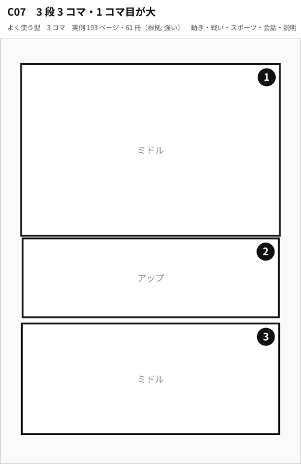

# C07 3 段 3 コマ・1 コマ目が大



- 種類: よく使う型、3 コマ
- 根拠: 実例 193 ページ・61 冊（強さ: 強い、全ページの 1.2%、最多の 1 冊が占める割合 15%）
- 向く場面: 動き・戦い・スポーツ（観測）、会話・説明（目的から）

## 目的

横長を 3 段に積み、時間を順に流す。中段の帯は顔の寄りになりやすい。

## 実際の漫画での使われ方

- 動き・戦い・スポーツの場面で多い（1.3 倍、10 冊）
- 女性漫画で多い（1.6 倍、43 ページ・7 冊）
- 1 ページの台詞は平均 5.59（全体 7.7）

## コマごとの中身（読む順）

1. **ミドル**（`medium`）: 腰から上がいちばん多い（31%）
2. **アップ**（`closeup`）: 顔の寄りが全体より多い（32%、全体の 2.1 倍）
3. **ミドル**（`medium`）: 腰から上がいちばん多い（29%）

## 避けるとき

縦の動き（落下・見上げ）。

## ネーム TOML の雛形

```toml
[[pages]]
number = 1
# 型 C07: 3 段 3 コマ・1 コマ目が大
tiers = [0.48, 0.22, 0.31]

  [[pages.panels]]   # 1
  tier = 0
  # 役割の目安: 腰から上がいちばん多い（31%）
  # shot = "medium"   # 目安: このコマでいちばん多い shot。場面に合わせて決める
  beat = ""

  [[pages.panels]]   # 2
  tier = 1
  # 役割の目安: 顔の寄りが全体より多い（32%、全体の 2.1 倍）
  # shot = "closeup"   # 目安: このコマで全体より多い shot（いちばん多いとは限らない）。場面に合わせて決める
  beat = ""

  [[pages.panels]]   # 3
  tier = 2
  # 役割の目安: 腰から上がいちばん多い（29%）
  # shot = "medium"   # 目安: このコマでいちばん多い shot。場面に合わせて決める
  beat = ""
```
