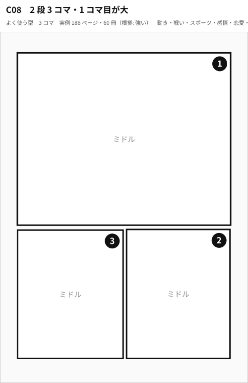

# C08 2 段 3 コマ・1 コマ目が大



- 種類: よく使う型、3 コマ
- 根拠: 実例 186 ページ・60 冊（強さ: 強い、全ページの 1.2%、最多の 1 冊が占める割合 6%）
- 向く場面: 動き・戦い・スポーツ（観測）、感情・恋愛・静けさ（目的から）

## 目的

上の大ゴマで出来事を見せ、下の 2 コマで反応や続きを左右に並べる（右が先）。

## 実際の漫画での使われ方

- 動き・戦い・スポーツの場面で多い（1.3 倍、13 冊）
- 右ページ（めくった先）で多い（65%）
- 1 ページの台詞は平均 4.68（全体 7.7）

## コマごとの中身（読む順）

1. **ミドル**（`medium`）: 腰から上がいちばん多い（34%）
2. **ミドル**（`medium`）: 腰から上がいちばん多い（30%）
3. **ミドル**（`medium`）: 腰から上がいちばん多い（33%）

## 避けるとき

細かい会話。

## ネーム TOML の雛形

```toml
[[pages]]
number = 1
# 型 C08: 2 段 3 コマ・1 コマ目が大
tiers = [0.57, 0.43]

  [[pages.panels]]   # 1
  tier = 0
  # 役割の目安: 腰から上がいちばん多い（34%）
  # shot = "medium"   # 目安: このコマでいちばん多い shot。場面に合わせて決める
  beat = ""

  [[pages.panels]]   # 2
  tier = 1
  width = 0.49
  # 役割の目安: 腰から上がいちばん多い（30%）
  # shot = "medium"   # 目安: このコマでいちばん多い shot。場面に合わせて決める
  beat = ""

  [[pages.panels]]   # 3
  tier = 1
  width = 0.51
  # 役割の目安: 腰から上がいちばん多い（33%）
  # shot = "medium"   # 目安: このコマでいちばん多い shot。場面に合わせて決める
  beat = ""
```
