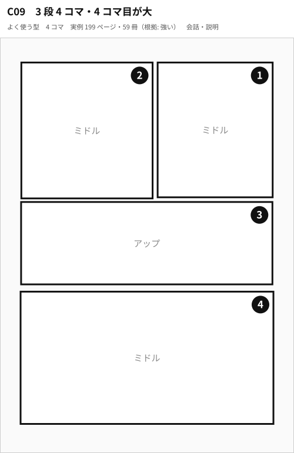

# C09 3 段 4 コマ・4 コマ目が大



- 種類: よく使う型、4 コマ
- 根拠: 実例 199 ページ・59 冊（強さ: 強い、全ページの 1.3%、最多の 1 冊が占める割合 7%）
- 向く場面: 会話・説明（目的から）

## 目的

上で会話を進め、帯の顔の寄りで受け、下の大ゴマで締める。

## 実際の漫画での使われ方

- 1 ページの台詞は平均 6.54（全体 7.7）

## コマごとの中身（読む順）

1. **ミドル**（`medium`）: 腰から上がいちばん多い（34%）
2. **ミドル**（`medium`）: 腰から上がいちばん多い（37%）
3. **アップ**（`closeup`）: 顔の寄りが全体より多い（29%、全体の 1.9 倍）
4. **ミドル**（`medium`）: 腰から上がいちばん多い（31%）

## 避けるとき

大ゴマを途中で見せたいとき（下に置くと最後に読まれる）。

## ネーム TOML の雛形

```toml
[[pages]]
number = 1
# 型 C09: 3 段 4 コマ・4 コマ目が大
tiers = [0.39, 0.24, 0.38]

  [[pages.panels]]   # 1
  tier = 0
  width = 0.47
  # 役割の目安: 腰から上がいちばん多い（34%）
  # shot = "medium"   # 目安: このコマでいちばん多い shot。場面に合わせて決める
  beat = ""

  [[pages.panels]]   # 2
  tier = 0
  width = 0.53
  # 役割の目安: 腰から上がいちばん多い（37%）
  # shot = "medium"   # 目安: このコマでいちばん多い shot。場面に合わせて決める
  beat = ""

  [[pages.panels]]   # 3
  tier = 1
  # 役割の目安: 顔の寄りが全体より多い（29%、全体の 1.9 倍）
  # shot = "closeup"   # 目安: このコマで全体より多い shot（いちばん多いとは限らない）。場面に合わせて決める
  beat = ""

  [[pages.panels]]   # 4
  tier = 2
  # 役割の目安: 腰から上がいちばん多い（31%）
  # shot = "medium"   # 目安: このコマでいちばん多い shot。場面に合わせて決める
  beat = ""
```
