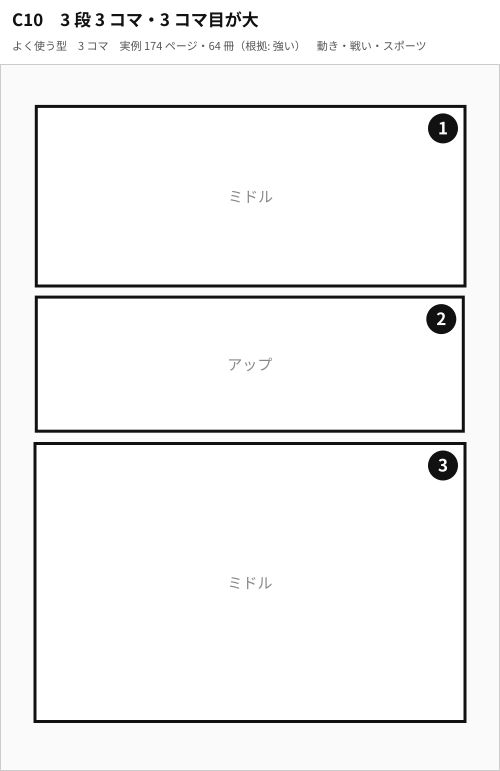

# C10 3 段 3 コマ・3 コマ目が大



- 種類: よく使う型、3 コマ
- 根拠: 実例 174 ページ・64 冊（強さ: 強い、全ページの 1.1%、最多の 1 冊が占める割合 16%）
- 向く場面: 動き・戦い・スポーツ（目的から）

## 目的

横長の帯 2 つ（2 つ目は顔の寄りが多い）で状況と表情を見せ、最後の大ゴマで大きく開く。

## 実際の漫画での使われ方

- 女性漫画で多い（2.1 倍、49 ページ・10 冊）
- 1 ページの台詞は平均 5.35（全体 7.7）

## コマごとの中身（読む順）

1. **ミドル**（`medium`）: 腰から上がいちばん多い（33%）
2. **アップ**（`closeup`）: 顔の寄りが全体より多い（38%、全体の 2.5 倍）
3. **ミドル**（`medium`）: 腰から上がいちばん多い（37%）

## 避けるとき

会話の往復（横長は二人を左右に並べにくい）。

## ネーム TOML の雛形

```toml
[[pages]]
number = 1
# 型 C10: 3 段 3 コマ・3 コマ目が大
tiers = [0.30, 0.23, 0.47]

  [[pages.panels]]   # 1
  tier = 0
  # 役割の目安: 腰から上がいちばん多い（33%）
  # shot = "medium"   # 目安: このコマでいちばん多い shot。場面に合わせて決める
  beat = ""

  [[pages.panels]]   # 2
  tier = 1
  # 役割の目安: 顔の寄りが全体より多い（38%、全体の 2.5 倍）
  # shot = "closeup"   # 目安: このコマで全体より多い shot（いちばん多いとは限らない）。場面に合わせて決める
  beat = ""

  [[pages.panels]]   # 3
  tier = 2
  # 役割の目安: 腰から上がいちばん多い（37%）
  # shot = "medium"   # 目安: このコマでいちばん多い shot。場面に合わせて決める
  beat = ""
```
