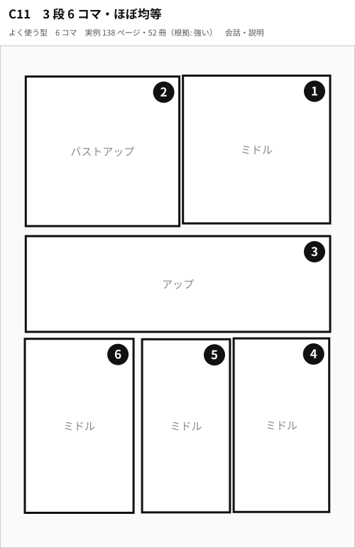

# C11 3 段 6 コマ・ほぼ均等



- 種類: よく使う型、6 コマ
- 根拠: 実例 138 ページ・52 冊（強さ: 強い、全ページの 0.9%、最多の 1 冊が占める割合 7%）
- 向く場面: 会話・説明（目的から）

## 目的

情報の多いページ。上で会話、中段の横長は顔の寄りで台詞が多く、下の 3 コマで反応を刻む。

## 実際の漫画での使われ方

- 1 ページの台詞は平均 8.94（全体 7.7）

## コマごとの中身（読む順）

1. **ミドル**（`medium`）: 腰から上がいちばん多い（33%）
2. **バストアップ**（`bust`）: 胸から上が全体より多い（30%、全体の 1.3 倍）
3. **アップ**（`closeup`）: 顔の寄りが全体より多い（30%、全体の 2.0 倍）、台詞が多い（平均 2）
4. **ミドル**（`medium`）: 腰から上がいちばん多い（39%）
5. **ミドル**（`medium`）: 腰から上がいちばん多い（36%）
6. **ミドル**（`medium`）: 腰から上がいちばん多い（30%）

## 避けるとき

見せ場。6 コマはどれも小さい。

## ネーム TOML の雛形

```toml
[[pages]]
number = 1
# 型 C11: 3 段 6 コマ・ほぼ均等
tiers = [0.36, 0.23, 0.41]

  [[pages.panels]]   # 1
  tier = 0
  width = 0.49
  # 役割の目安: 腰から上がいちばん多い（33%）
  # shot = "medium"   # 目安: このコマでいちばん多い shot。場面に合わせて決める
  beat = ""

  [[pages.panels]]   # 2
  tier = 0
  width = 0.51
  # 役割の目安: 胸から上が全体より多い（30%、全体の 1.3 倍）
  # shot = "bust"   # 目安: このコマで全体より多い shot（いちばん多いとは限らない）。場面に合わせて決める
  beat = ""

  [[pages.panels]]   # 3
  tier = 1
  # 役割の目安: 顔の寄りが全体より多い（30%、全体の 2.0 倍）、台詞が多い（平均 2）
  # shot = "closeup"   # 目安: このコマで全体より多い shot（いちばん多いとは限らない）。場面に合わせて決める
  beat = ""

  [[pages.panels]]   # 4
  tier = 2
  width = 0.33
  # 役割の目安: 腰から上がいちばん多い（39%）
  # shot = "medium"   # 目安: このコマでいちばん多い shot。場面に合わせて決める
  beat = ""

  [[pages.panels]]   # 5
  tier = 2
  width = 0.30
  # 役割の目安: 腰から上がいちばん多い（36%）
  # shot = "medium"   # 目安: このコマでいちばん多い shot。場面に合わせて決める
  beat = ""

  [[pages.panels]]   # 6
  tier = 2
  width = 0.37
  # 役割の目安: 腰から上がいちばん多い（30%）
  # shot = "medium"   # 目安: このコマでいちばん多い shot。場面に合わせて決める
  beat = ""
```
