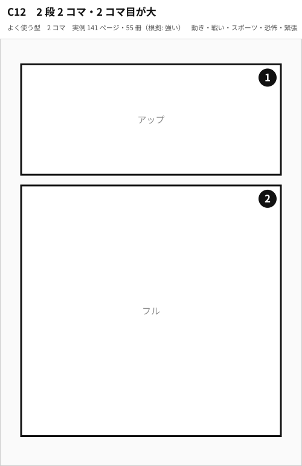

# C12 2 段 2 コマ・2 コマ目が大



- 種類: よく使う型、2 コマ
- 根拠: 実例 141 ページ・55 冊（強さ: 強い、全ページの 0.9%、最多の 1 冊が占める割合 6%）
- 向く場面: 動き・戦い・スポーツ（観測）、恐怖・緊張（観測）

## 目的

上の横長で気配や表情を見せ、下の大ゴマを全身と擬音で開く。言葉が少ない。

## 実際の漫画での使われ方

- 扉・章の頭の場面で多い（2.9 倍、10 冊）
- 動き・戦い・スポーツの場面で多い（1.4 倍、10 冊）
- 恐怖・緊張の場面で多い（1.4 倍、14 冊）
- 単行本の終わり 1 割で多い（15%、全体 8%）
- 1 ページの台詞は平均 3.65（全体 7.7）

## コマごとの中身（読む順）

1. **アップ**（`closeup`）: 顔の寄りが全体より多い（25%、全体の 1.6 倍）
2. **フル**（`full`）: 全身が全体より多い（29%、全体の 3.5 倍）、擬音が多い（平均 1.02）

## 避けるとき

会話の多いページ。

## ネーム TOML の雛形

```toml
[[pages]]
number = 1
# 型 C12: 2 段 2 コマ・2 コマ目が大
tiers = [0.31, 0.69]

  [[pages.panels]]   # 1
  tier = 0
  # 役割の目安: 顔の寄りが全体より多い（25%、全体の 1.6 倍）
  # shot = "closeup"   # 目安: このコマで全体より多い shot（いちばん多いとは限らない）。場面に合わせて決める
  beat = ""

  [[pages.panels]]   # 2
  tier = 1
  # 役割の目安: 全身が全体より多い（29%、全体の 3.5 倍）、擬音が多い（平均 1.02）
  # shot = "full"   # 目安: このコマで全体より多い shot（いちばん多いとは限らない）。場面に合わせて決める
  beat = ""
```
