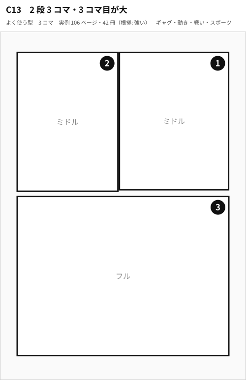

# C13 2 段 3 コマ・3 コマ目が大



- 種類: よく使う型、3 コマ
- 根拠: 実例 106 ページ・42 冊（強さ: 強い、全ページの 0.7%、最多の 1 冊が占める割合 10%）
- 向く場面: ギャグ（観測・少数の作品）、動き・戦い・スポーツ（目的から）

## 目的

上の 2 コマ（1 コマ目は無言が多い）で振り、下の大ゴマで全身を見せる・落とす。

## 実際の漫画での使われ方

- ギャグの場面でやや多い（2.4 倍、ただし 4 冊だけ）
- 扉・章の頭の場面でやや多い（2.0 倍、ただし 6 冊だけ）
- 右ページ（めくった先）で多い（61%）
- 単行本の終わり 1 割で多い（14%、全体 8%）
- 1 ページの台詞は平均 4.4（全体 7.7）

## コマごとの中身（読む順）

1. **ミドル**（`medium`）: 腰から上がいちばん多い（38%）、無言が全体より多い（35%、全体 23%）
2. **ミドル**（`medium`）: 腰から上がいちばん多い（34%）
3. **フル**（`full`）: 全身が全体より多い（28%、全体の 3.4 倍）

## 避けるとき

大ゴマの後にまだ話が続くとき。

## ネーム TOML の雛形

```toml
[[pages]]
number = 1
# 型 C13: 2 段 3 コマ・3 コマ目が大
tiers = [0.47, 0.53]

  [[pages.panels]]   # 1
  tier = 0
  width = 0.52
  # 役割の目安: 腰から上がいちばん多い（38%）、無言が全体より多い（35%、全体 23%）
  # shot = "medium"   # 目安: このコマでいちばん多い shot。場面に合わせて決める
  beat = ""

  [[pages.panels]]   # 2
  tier = 0
  width = 0.48
  # 役割の目安: 腰から上がいちばん多い（34%）
  # shot = "medium"   # 目安: このコマでいちばん多い shot。場面に合わせて決める
  beat = ""

  [[pages.panels]]   # 3
  tier = 1
  # 役割の目安: 全身が全体より多い（28%、全体の 3.4 倍）
  # shot = "full"   # 目安: このコマで全体より多い shot（いちばん多いとは限らない）。場面に合わせて決める
  beat = ""
```
