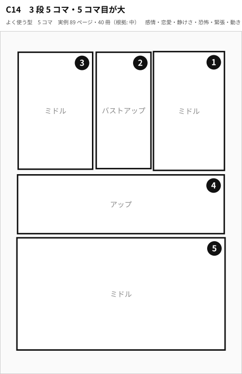

# C14 3 段 5 コマ・5 コマ目が大



- 種類: よく使う型、5 コマ
- 根拠: 実例 89 ページ・40 冊（強さ: 中、全ページの 0.6%、最多の 1 冊が占める割合 8%）
- 向く場面: 感情・恋愛・静けさ（観測）、恐怖・緊張（観測）、動き・戦い・スポーツ（目的から）

## 目的

上の 3 コマで溜め（2 コマ目は一人の胸から上が多い）、帯の顔の寄りで一拍、下の大ゴマで見せる。

## 実際の漫画での使われ方

- 感情・恋愛・静けさの場面で多い（1.6 倍、13 冊）
- 恐怖・緊張の場面で多い（1.4 倍、11 冊）
- 少女漫画で多い（2.3 倍、47 ページ・17 冊）
- 1 ページの台詞は平均 7.28（全体 7.7）

## コマごとの中身（読む順）

1. **ミドル**（`medium`）: 腰から上がいちばん多い（33%）
2. **バストアップ**（`bust`）: 胸から上が全体より多い（34%、全体の 1.5 倍）、一人が多い（65%）
3. **ミドル**（`medium`）: 腰から上がいちばん多い（36%）
4. **アップ**（`closeup`）: 顔の寄りが全体より多い（34%、全体の 2.2 倍）
5. **ミドル**（`medium`）: 腰から上がいちばん多い（33%）

## 避けるとき

溜める理由の無い会話（溜めが空振りになる）。

## ネーム TOML の雛形

```toml
[[pages]]
number = 1
# 型 C14: 3 段 5 コマ・5 コマ目が大
tiers = [0.41, 0.20, 0.39]

  [[pages.panels]]   # 1
  tier = 0
  width = 0.35
  # 役割の目安: 腰から上がいちばん多い（33%）
  # shot = "medium"   # 目安: このコマでいちばん多い shot。場面に合わせて決める
  beat = ""

  [[pages.panels]]   # 2
  tier = 0
  width = 0.27
  # 役割の目安: 胸から上が全体より多い（34%、全体の 1.5 倍）、一人が多い（65%）
  # shot = "bust"   # 目安: このコマで全体より多い shot（いちばん多いとは限らない）。場面に合わせて決める
  beat = ""

  [[pages.panels]]   # 3
  tier = 0
  width = 0.37
  # 役割の目安: 腰から上がいちばん多い（36%）
  # shot = "medium"   # 目安: このコマでいちばん多い shot。場面に合わせて決める
  beat = ""

  [[pages.panels]]   # 4
  tier = 1
  # 役割の目安: 顔の寄りが全体より多い（34%、全体の 2.2 倍）
  # shot = "closeup"   # 目安: このコマで全体より多い shot（いちばん多いとは限らない）。場面に合わせて決める
  beat = ""

  [[pages.panels]]   # 5
  tier = 2
  # 役割の目安: 腰から上がいちばん多い（33%）
  # shot = "medium"   # 目安: このコマでいちばん多い shot。場面に合わせて決める
  beat = ""
```
