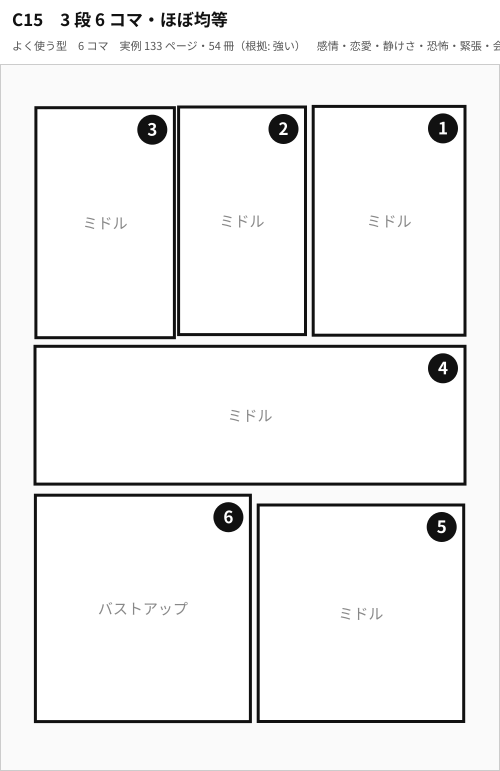

# C15 3 段 6 コマ・ほぼ均等



- 種類: よく使う型、6 コマ
- 根拠: 実例 133 ページ・54 冊（強さ: 強い、全ページの 0.9%、最多の 1 冊が占める割合 7%）
- 向く場面: 感情・恋愛・静けさ（観測）、恐怖・緊張（観測）、会話・説明（目的から）

## 目的

上の 3 コマで刻み、中段の横長でつなぎ、下の 2 コマで受ける。感情が揺れる細かいページ。

## 実際の漫画での使われ方

- 感情・恋愛・静けさの場面で多い（1.3 倍、16 冊）
- 恐怖・緊張の場面で多い（1.3 倍、12 冊）
- 少女漫画で多い（1.7 倍、52 ページ・13 冊）
- 1 ページの台詞は平均 9.29（全体 7.7）

## コマごとの中身（読む順）

1. **ミドル**（`medium`）: 腰から上がいちばん多い（36%）
2. **ミドル**（`medium`）: 腰から上がいちばん多い（37%）、無言が全体より多い（32%、全体 23%）
3. **ミドル**（`medium`）: 腰から上がいちばん多い（35%）
4. **ミドル**（`medium`）: 腰から上が全体より多い（42%、全体の 1.4 倍）
5. **ミドル**（`medium`）: 腰から上がいちばん多い（33%）
6. **バストアップ**（`bust`）: 胸から上が全体より多い（30%、全体の 1.4 倍）

## 避けるとき

めくった直後の見せ（大きなコマが無い）。

## ネーム TOML の雛形

```toml
[[pages]]
number = 1
# 型 C15: 3 段 6 コマ・ほぼ均等
tiers = [0.39, 0.23, 0.38]

  [[pages.panels]]   # 1
  tier = 0
  width = 0.36
  # 役割の目安: 腰から上がいちばん多い（36%）
  # shot = "medium"   # 目安: このコマでいちばん多い shot。場面に合わせて決める
  beat = ""

  [[pages.panels]]   # 2
  tier = 0
  width = 0.30
  # 役割の目安: 腰から上がいちばん多い（37%）、無言が全体より多い（32%、全体 23%）
  # shot = "medium"   # 目安: このコマでいちばん多い shot。場面に合わせて決める
  beat = ""

  [[pages.panels]]   # 3
  tier = 0
  width = 0.33
  # 役割の目安: 腰から上がいちばん多い（35%）
  # shot = "medium"   # 目安: このコマでいちばん多い shot。場面に合わせて決める
  beat = ""

  [[pages.panels]]   # 4
  tier = 1
  # 役割の目安: 腰から上が全体より多い（42%、全体の 1.4 倍）
  # shot = "medium"   # 目安: このコマで全体より多い shot（いちばん多いとは限らない）。場面に合わせて決める
  beat = ""

  [[pages.panels]]   # 5
  tier = 2
  width = 0.49
  # 役割の目安: 腰から上がいちばん多い（33%）
  # shot = "medium"   # 目安: このコマでいちばん多い shot。場面に合わせて決める
  beat = ""

  [[pages.panels]]   # 6
  tier = 2
  width = 0.51
  # 役割の目安: 胸から上が全体より多い（30%、全体の 1.4 倍）
  # shot = "bust"   # 目安: このコマで全体より多い shot（いちばん多いとは限らない）。場面に合わせて決める
  beat = ""
```
