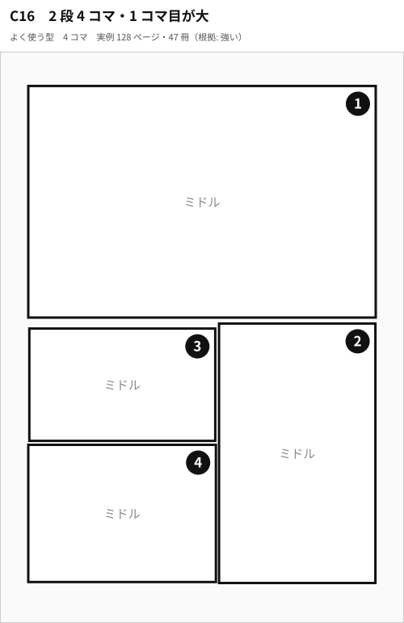

# C16 2 段 4 コマ・1 コマ目が大



- 種類: よく使う型、4 コマ
- 根拠: 実例 128 ページ・47 冊（強さ: 強い、全ページの 0.8%、最多の 1 冊が占める割合 11%）

## 目的

上の大ゴマは無言が多く（約 4 割）、場面を見せる。右下の縦長と左の 2 コマで会話に入る。

## 実際の漫画での使われ方

- 1 ページの台詞は平均 6.22（全体 7.7）

## コマごとの中身（読む順）

1. **ミドル**（`medium`）: 腰から上がいちばん多い（31%）、無言が全体より多い（41%、全体 23%）
2. **ミドル**（`medium`）: 腰から上がいちばん多い（34%）
3. **ミドル**（`medium`）: 腰から上がいちばん多い（31%）、台詞のあることが多い（無言 12%）
4. **ミドル**（`medium`）: 腰から上がいちばん多い（32%）

## 避けるとき

人物の表情を大きく見せたいとき。

## ネーム TOML の雛形

```toml
[[pages]]
number = 1
# 型 C16: 2 段 4 コマ・1 コマ目が大
tiers = [0.47, 0.53]

  [[pages.panels]]   # 1
  tier = 0
  # 役割の目安: 腰から上がいちばん多い（31%）、無言が全体より多い（41%、全体 23%）
  # shot = "medium"   # 目安: このコマでいちばん多い shot。場面に合わせて決める
  beat = ""

  [[pages.panels]]   # 2
  tier = 1
  width = 0.45
  # 役割の目安: 腰から上がいちばん多い（34%）
  # shot = "medium"   # 目安: このコマでいちばん多い shot。場面に合わせて決める
  beat = ""

  [[pages.panels]]   # 3
  tier = 1
  width = 0.55
  column = 2
  height = 0.45
  # 役割の目安: 腰から上がいちばん多い（31%）、台詞のあることが多い（無言 12%）
  # shot = "medium"   # 目安: このコマでいちばん多い shot。場面に合わせて決める
  beat = ""

  [[pages.panels]]   # 4
  tier = 1
  column = 2
  height = 0.55
  # 役割の目安: 腰から上がいちばん多い（32%）
  # shot = "medium"   # 目安: このコマでいちばん多い shot。場面に合わせて決める
  beat = ""
```
