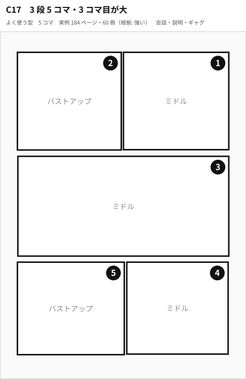

# C17 3 段 5 コマ・3 コマ目が大



- 種類: よく使う型、5 コマ
- 根拠: 実例 184 ページ・60 冊（強さ: 強い、全ページの 1.2%、最多の 1 冊が占める割合 7%）
- 向く場面: 会話・説明（観測）、ギャグ（観測・少数の作品）

## 目的

上下の 2 コマで会話、中段の大きめの横長に二人以上を並べる。

## 実際の漫画での使われ方

- 会話・説明の場面で多い（1.4 倍、22 冊）
- ギャグの場面でやや多い（2.7 倍、ただし 7 冊だけ）
- 1 ページの台詞は平均 7.85（全体 7.7）

## コマごとの中身（読む順）

1. **ミドル**（`medium`）: 腰から上がいちばん多い（32%）
2. **バストアップ**（`bust`）: 胸から上が全体より多い（33%、全体の 1.5 倍）
3. **ミドル**（`medium`）: 腰から上がいちばん多い（39%）、二人以上が多い（53%）
4. **ミドル**（`medium`）: 腰から上がいちばん多い（34%）
5. **バストアップ**（`bust`）: 胸から上が全体より多い（30%、全体の 1.4 倍）

## 避けるとき

台詞の無い見せ場。

## ネーム TOML の雛形

```toml
[[pages]]
number = 1
# 型 C17: 3 段 5 コマ・3 コマ目が大
tiers = [0.34, 0.34, 0.32]

  [[pages.panels]]   # 1
  tier = 0
  width = 0.50
  # 役割の目安: 腰から上がいちばん多い（32%）
  # shot = "medium"   # 目安: このコマでいちばん多い shot。場面に合わせて決める
  beat = ""

  [[pages.panels]]   # 2
  tier = 0
  width = 0.50
  # 役割の目安: 胸から上が全体より多い（33%、全体の 1.5 倍）
  # shot = "bust"   # 目安: このコマで全体より多い shot（いちばん多いとは限らない）。場面に合わせて決める
  beat = ""

  [[pages.panels]]   # 3
  tier = 1
  # 役割の目安: 腰から上がいちばん多い（39%）、二人以上が多い（53%）
  # shot = "medium"   # 目安: このコマでいちばん多い shot。場面に合わせて決める
  beat = ""

  [[pages.panels]]   # 4
  tier = 2
  width = 0.49
  # 役割の目安: 腰から上がいちばん多い（34%）
  # shot = "medium"   # 目安: このコマでいちばん多い shot。場面に合わせて決める
  beat = ""

  [[pages.panels]]   # 5
  tier = 2
  width = 0.51
  # 役割の目安: 胸から上が全体より多い（30%、全体の 1.4 倍）
  # shot = "bust"   # 目安: このコマで全体より多い shot（いちばん多いとは限らない）。場面に合わせて決める
  beat = ""
```
