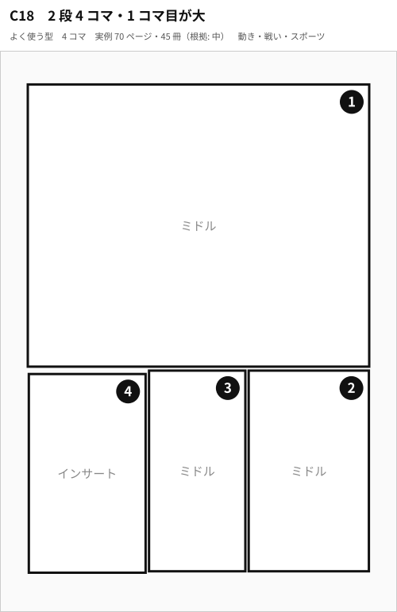

# C18 2 段 4 コマ・1 コマ目が大



- 種類: よく使う型、4 コマ
- 根拠: 実例 70 ページ・45 冊（強さ: 中、全ページの 0.4%、最多の 1 冊が占める割合 9%）
- 向く場面: 動き・戦い・スポーツ（観測・少数の作品）

## 目的

上の大ゴマで見せ（無言と擬音が多い）、下の 3 コマに反応と物の寄りを並べる。

## 実際の漫画での使われ方

- 動き・戦い・スポーツの場面でやや多い（1.4 倍、ただし 6 冊だけ）
- 1 ページの台詞は平均 5（全体 7.7）

## コマごとの中身（読む順）

1. **ミドル**（`medium`）: 腰から上が全体より多い（51%、全体の 1.7 倍）、無言が全体より多い（31%、全体 23%）、擬音が多い（平均 1.03）
2. **ミドル**（`medium`）: 腰から上がいちばん多い（33%）、無言が全体より多い（34%、全体 23%）
3. **ミドル**（`medium`）: 腰から上が全体より多い（46%、全体の 1.5 倍）、一人が多い（61%）
4. **インサート**（`insert`）: 人物なし（物・景色・手元）が全体より多い（29%、全体の 1.6 倍）、無言が全体より多い（31%、全体 23%）

## 避けるとき

続けて使うと平ら。

## ネーム TOML の雛形

```toml
[[pages]]
number = 1
# 型 C18: 2 段 4 コマ・1 コマ目が大
tiers = [0.58, 0.42]

  [[pages.panels]]   # 1
  tier = 0
  # 役割の目安: 腰から上が全体より多い（51%、全体の 1.7 倍）、無言が全体より多い（31%、全体 23%）、擬音が多い（平均 1.03）
  # shot = "medium"   # 目安: このコマで全体より多い shot（いちばん多いとは限らない）。場面に合わせて決める
  beat = ""

  [[pages.panels]]   # 2
  tier = 1
  width = 0.36
  # 役割の目安: 腰から上がいちばん多い（33%）、無言が全体より多い（34%、全体 23%）
  # shot = "medium"   # 目安: このコマでいちばん多い shot。場面に合わせて決める
  beat = ""

  [[pages.panels]]   # 3
  tier = 1
  width = 0.29
  # 役割の目安: 腰から上が全体より多い（46%、全体の 1.5 倍）、一人が多い（61%）
  # shot = "medium"   # 目安: このコマで全体より多い shot（いちばん多いとは限らない）。場面に合わせて決める
  beat = ""

  [[pages.panels]]   # 4
  tier = 1
  width = 0.35
  # 役割の目安: 人物なし（物・景色・手元）が全体より多い（29%、全体の 1.6 倍）、無言が全体より多い（31%、全体 23%）
  # shot = "insert"   # 目安: このコマで全体より多い shot（いちばん多いとは限らない）。場面に合わせて決める
  beat = ""
```
