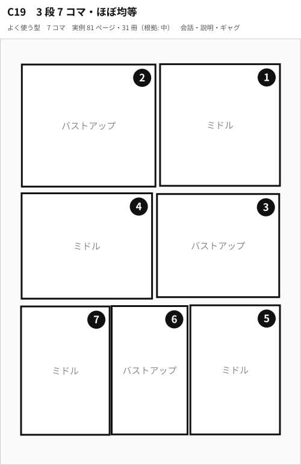

# C19 3 段 7 コマ・ほぼ均等



- 種類: よく使う型、7 コマ
- 根拠: 実例 81 ページ・31 冊（強さ: 中、全ページの 0.5%、最多の 1 冊が占める割合 25%）
- 向く場面: 会話・説明（目的から）、ギャグ（目的から）

## 目的

最も情報の多い 7 コマ。ドタバタ、速い掛け合い、説明。

## 実際の漫画での使われ方

- 左ページ（めくる前）でやや多い（58%）
- 少年漫画で多い（1.5 倍、43 ページ・13 冊）
- 1 ページの台詞は平均 9.64（全体 7.7）

## コマごとの中身（読む順）

1. **ミドル**（`medium`）: 腰から上が全体より多い（44%、全体の 1.4 倍）
2. **バストアップ**（`bust`）: 胸から上が全体より多い（32%、全体の 1.4 倍）
3. **バストアップ**（`bust`）: 胸から上が全体より多い（30%、全体の 1.3 倍）
4. **ミドル**（`medium`）: 腰から上がいちばん多い（40%）
5. **ミドル**（`medium`）: 腰から上がいちばん多い（35%）
6. **バストアップ**（`bust`）: 胸から上が全体より多い（33%、全体の 1.5 倍）、一人が多い（69%）
7. **ミドル**（`medium`）: 腰から上が全体より多い（41%、全体の 1.3 倍）

## 避けるとき

感情の山場（コマが小さく、顔が描けない）。

## ネーム TOML の雛形

```toml
[[pages]]
number = 1
# 型 C19: 3 段 7 コマ・ほぼ均等
tiers = [0.34, 0.29, 0.36]

  [[pages.panels]]   # 1
  tier = 0
  width = 0.47
  # 役割の目安: 腰から上が全体より多い（44%、全体の 1.4 倍）
  # shot = "medium"   # 目安: このコマで全体より多い shot（いちばん多いとは限らない）。場面に合わせて決める
  beat = ""

  [[pages.panels]]   # 2
  tier = 0
  width = 0.53
  # 役割の目安: 胸から上が全体より多い（32%、全体の 1.4 倍）
  # shot = "bust"   # 目安: このコマで全体より多い shot（いちばん多いとは限らない）。場面に合わせて決める
  beat = ""

  [[pages.panels]]   # 3
  tier = 1
  width = 0.48
  # 役割の目安: 胸から上が全体より多い（30%、全体の 1.3 倍）
  # shot = "bust"   # 目安: このコマで全体より多い shot（いちばん多いとは限らない）。場面に合わせて決める
  beat = ""

  [[pages.panels]]   # 4
  tier = 1
  width = 0.52
  # 役割の目安: 腰から上がいちばん多い（40%）
  # shot = "medium"   # 目安: このコマでいちばん多い shot。場面に合わせて決める
  beat = ""

  [[pages.panels]]   # 5
  tier = 2
  width = 0.35
  # 役割の目安: 腰から上がいちばん多い（35%）
  # shot = "medium"   # 目安: このコマでいちばん多い shot。場面に合わせて決める
  beat = ""

  [[pages.panels]]   # 6
  tier = 2
  width = 0.30
  # 役割の目安: 胸から上が全体より多い（33%、全体の 1.5 倍）、一人が多い（69%）
  # shot = "bust"   # 目安: このコマで全体より多い shot（いちばん多いとは限らない）。場面に合わせて決める
  beat = ""

  [[pages.panels]]   # 7
  tier = 2
  width = 0.35
  # 役割の目安: 腰から上が全体より多い（41%、全体の 1.3 倍）
  # shot = "medium"   # 目安: このコマで全体より多い shot（いちばん多いとは限らない）。場面に合わせて決める
  beat = ""
```
