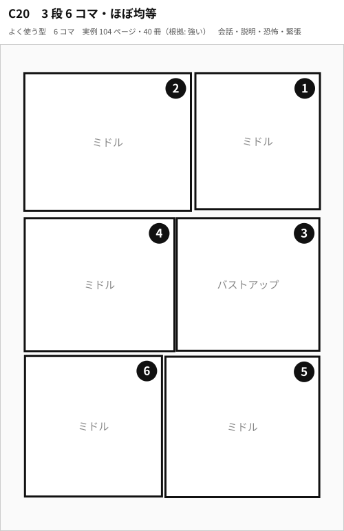

# C20 3 段 6 コマ・ほぼ均等



- 種類: よく使う型、6 コマ
- 根拠: 実例 104 ページ・40 冊（強さ: 強い、全ページの 0.7%、最多の 1 冊が占める割合 14%）
- 向く場面: 会話・説明（目的から）、恐怖・緊張（目的から）

## 目的

均等な 6 コマの会話劇。二人以上のコマが多く、無言のコマは少ない。

## 実際の漫画での使われ方

- 少年漫画で多い（1.6 倍、57 ページ・15 冊）
- 1 ページの台詞は平均 9.13（全体 7.7）

## コマごとの中身（読む順）

1. **ミドル**（`medium`）: 腰から上がいちばん多い（30%）
2. **ミドル**（`medium`）: 腰から上が全体より多い（43%、全体の 1.4 倍）、台詞のあることが多い（無言 12%）、二人以上が多い（51%）
3. **バストアップ**（`bust`）: 胸から上が全体より多い（30%、全体の 1.3 倍）
4. **ミドル**（`medium`）: 腰から上がいちばん多い（36%）、二人以上が多い（56%）
5. **ミドル**（`medium`）: 腰から上が全体より多い（40%、全体の 1.3 倍）、二人以上が多い（56%）
6. **ミドル**（`medium`）: 腰から上がいちばん多い（35%）

## 避けるとき

感情の山場、動き。

## ネーム TOML の雛形

```toml
[[pages]]
number = 1
# 型 C20: 3 段 6 コマ・ほぼ均等
tiers = [0.33, 0.32, 0.34]

  [[pages.panels]]   # 1
  tier = 0
  width = 0.43
  # 役割の目安: 腰から上がいちばん多い（30%）
  # shot = "medium"   # 目安: このコマでいちばん多い shot。場面に合わせて決める
  beat = ""

  [[pages.panels]]   # 2
  tier = 0
  width = 0.57
  # 役割の目安: 腰から上が全体より多い（43%、全体の 1.4 倍）、台詞のあることが多い（無言 12%）、二人以上が多い（51%）
  # shot = "medium"   # 目安: このコマで全体より多い shot（いちばん多いとは限らない）。場面に合わせて決める
  beat = ""

  [[pages.panels]]   # 3
  tier = 1
  width = 0.49
  # 役割の目安: 胸から上が全体より多い（30%、全体の 1.3 倍）
  # shot = "bust"   # 目安: このコマで全体より多い shot（いちばん多いとは限らない）。場面に合わせて決める
  beat = ""

  [[pages.panels]]   # 4
  tier = 1
  width = 0.51
  # 役割の目安: 腰から上がいちばん多い（36%）、二人以上が多い（56%）
  # shot = "medium"   # 目安: このコマでいちばん多い shot。場面に合わせて決める
  beat = ""

  [[pages.panels]]   # 5
  tier = 2
  width = 0.53
  # 役割の目安: 腰から上が全体より多い（40%、全体の 1.3 倍）、二人以上が多い（56%）
  # shot = "medium"   # 目安: このコマで全体より多い shot（いちばん多いとは限らない）。場面に合わせて決める
  beat = ""

  [[pages.panels]]   # 6
  tier = 2
  width = 0.47
  # 役割の目安: 腰から上がいちばん多い（35%）
  # shot = "medium"   # 目安: このコマでいちばん多い shot。場面に合わせて決める
  beat = ""
```
