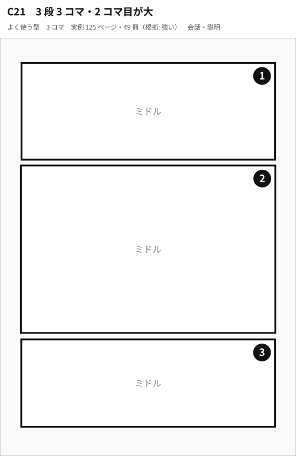

# C21 3 段 3 コマ・2 コマ目が大



- 種類: よく使う型、3 コマ
- 根拠: 実例 125 ページ・49 冊（強さ: 強い、全ページの 0.8%、最多の 1 冊が占める割合 14%）
- 向く場面: 会話・説明（目的から）

## 目的

上下の横長で挟み、中段の大ゴマに台詞の多いやりとりを置く。3 コマとも腰から上が中心。

## 実際の漫画での使われ方

- 女性漫画で多い（1.7 倍、29 ページ・7 冊）
- 1 ページの台詞は平均 5.64（全体 7.7）

## コマごとの中身（読む順）

1. **ミドル**（`medium`）: 腰から上がいちばん多い（31%）
2. **ミドル**（`medium`）: 腰から上がいちばん多い（33%）、台詞が多い（平均 2.03）
3. **ミドル**（`medium`）: 腰から上がいちばん多い（29%）

## 避けるとき

一人の表情の山場。

## ネーム TOML の雛形

```toml
[[pages]]
number = 1
# 型 C21: 3 段 3 コマ・2 コマ目が大
tiers = [0.28, 0.48, 0.25]

  [[pages.panels]]   # 1
  tier = 0
  # 役割の目安: 腰から上がいちばん多い（31%）
  # shot = "medium"   # 目安: このコマでいちばん多い shot。場面に合わせて決める
  beat = ""

  [[pages.panels]]   # 2
  tier = 1
  # 役割の目安: 腰から上がいちばん多い（33%）、台詞が多い（平均 2.03）
  # shot = "medium"   # 目安: このコマでいちばん多い shot。場面に合わせて決める
  beat = ""

  [[pages.panels]]   # 3
  tier = 2
  # 役割の目安: 腰から上がいちばん多い（29%）
  # shot = "medium"   # 目安: このコマでいちばん多い shot。場面に合わせて決める
  beat = ""
```
