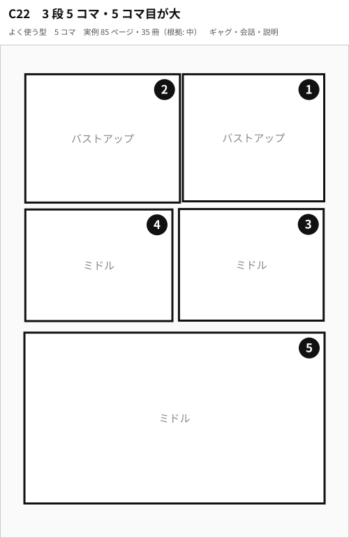

# C22 3 段 5 コマ・5 コマ目が大



- 種類: よく使う型、5 コマ
- 根拠: 実例 85 ページ・35 冊（強さ: 中、全ページの 0.5%、最多の 1 冊が占める割合 15%）
- 向く場面: ギャグ（目的から）、会話・説明（目的から）

## 目的

上の 4 コマで掛け合いを回し、下の大ゴマに二人以上を入れて台詞も多く締める。

## 実際の漫画での使われ方

- 単行本の終わり 1 割で多い（14%、全体 8%）
- 青年漫画で多い（1.6 倍、38 ページ・13 冊）
- 1 ページの台詞は平均 8.8（全体 7.7）

## コマごとの中身（読む順）

1. **バストアップ**（`bust`）: 胸から上が全体より多い（32%、全体の 1.4 倍）
2. **バストアップ**（`bust`）: 胸から上が全体より多い（29%、全体の 1.3 倍）、台詞のあることが多い（無言 12%）
3. **ミドル**（`medium`）: 腰から上がいちばん多い（39%）
4. **ミドル**（`medium`）: 腰から上がいちばん多い（34%）
5. **ミドル**（`medium`）: 腰から上が全体より多い（44%、全体の 1.4 倍）、台詞が多い（平均 2）、二人以上が多い（58%）

## 避けるとき

静かな感情の場面。

## ネーム TOML の雛形

```toml
[[pages]]
number = 1
# 型 C22: 3 段 5 コマ・5 コマ目が大
tiers = [0.31, 0.27, 0.42]

  [[pages.panels]]   # 1
  tier = 0
  width = 0.48
  # 役割の目安: 胸から上が全体より多い（32%、全体の 1.4 倍）
  # shot = "bust"   # 目安: このコマで全体より多い shot（いちばん多いとは限らない）。場面に合わせて決める
  beat = ""

  [[pages.panels]]   # 2
  tier = 0
  width = 0.52
  # 役割の目安: 胸から上が全体より多い（29%、全体の 1.3 倍）、台詞のあることが多い（無言 12%）
  # shot = "bust"   # 目安: このコマで全体より多い shot（いちばん多いとは限らない）。場面に合わせて決める
  beat = ""

  [[pages.panels]]   # 3
  tier = 1
  width = 0.50
  # 役割の目安: 腰から上がいちばん多い（39%）
  # shot = "medium"   # 目安: このコマでいちばん多い shot。場面に合わせて決める
  beat = ""

  [[pages.panels]]   # 4
  tier = 1
  width = 0.50
  # 役割の目安: 腰から上がいちばん多い（34%）
  # shot = "medium"   # 目安: このコマでいちばん多い shot。場面に合わせて決める
  beat = ""

  [[pages.panels]]   # 5
  tier = 2
  # 役割の目安: 腰から上が全体より多い（44%、全体の 1.4 倍）、台詞が多い（平均 2）、二人以上が多い（58%）
  # shot = "medium"   # 目安: このコマで全体より多い shot（いちばん多いとは限らない）。場面に合わせて決める
  beat = ""
```
