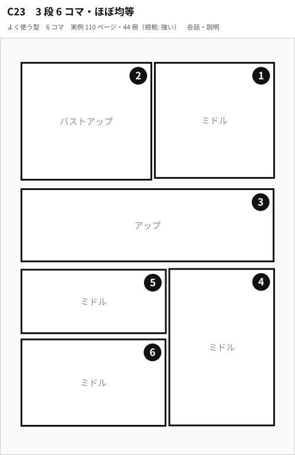

# C23 3 段 6 コマ・ほぼ均等



- 種類: よく使う型、6 コマ
- 根拠: 実例 110 ページ・44 冊（強さ: 強い、全ページの 0.7%、最多の 1 冊が占める割合 11%）
- 向く場面: 会話・説明（目的から）

## 目的

会話の多いページ。右下の縦長（読む順で 4 番目）に二人以上を入れ、ほぼ必ず台詞を置く。

## 実際の漫画での使われ方

- 左ページ（めくる前）でやや多い（58%）
- 1 ページの台詞は平均 9.84（全体 7.7）

## コマごとの中身（読む順）

1. **ミドル**（`medium`）: 腰から上がいちばん多い（36%）、二人以上が多い（52%）
2. **バストアップ**（`bust`）: 胸から上が全体より多い（32%、全体の 1.4 倍）
3. **アップ**（`closeup`）: 顔の寄りが全体より多い（25%、全体の 1.6 倍）、二人以上が多い（57%）
4. **ミドル**（`medium`）: 腰から上が全体より多い（41%、全体の 1.3 倍）、台詞のあることが多い（無言 8%）、二人以上が多い（60%）
5. **ミドル**（`medium`）: 腰から上がいちばん多い（31%）
6. **ミドル**（`medium`）: 腰から上がいちばん多い（33%）

## 避けるとき

めくった直後。

## ネーム TOML の雛形

```toml
[[pages]]
number = 1
# 型 C23: 3 段 6 コマ・ほぼ均等
tiers = [0.34, 0.21, 0.45]

  [[pages.panels]]   # 1
  tier = 0
  width = 0.48
  # 役割の目安: 腰から上がいちばん多い（36%）、二人以上が多い（52%）
  # shot = "medium"   # 目安: このコマでいちばん多い shot。場面に合わせて決める
  beat = ""

  [[pages.panels]]   # 2
  tier = 0
  width = 0.52
  # 役割の目安: 胸から上が全体より多い（32%、全体の 1.4 倍）
  # shot = "bust"   # 目安: このコマで全体より多い shot（いちばん多いとは限らない）。場面に合わせて決める
  beat = ""

  [[pages.panels]]   # 3
  tier = 1
  # 役割の目安: 顔の寄りが全体より多い（25%、全体の 1.6 倍）、二人以上が多い（57%）
  # shot = "closeup"   # 目安: このコマで全体より多い shot（いちばん多いとは限らない）。場面に合わせて決める
  beat = ""

  [[pages.panels]]   # 4
  tier = 2
  width = 0.42
  # 役割の目安: 腰から上が全体より多い（41%、全体の 1.3 倍）、台詞のあることが多い（無言 8%）、二人以上が多い（60%）
  # shot = "medium"   # 目安: このコマで全体より多い shot（いちばん多いとは限らない）。場面に合わせて決める
  beat = ""

  [[pages.panels]]   # 5
  tier = 2
  width = 0.58
  column = 2
  height = 0.42
  # 役割の目安: 腰から上がいちばん多い（31%）
  # shot = "medium"   # 目安: このコマでいちばん多い shot。場面に合わせて決める
  beat = ""

  [[pages.panels]]   # 6
  tier = 2
  column = 2
  height = 0.58
  # 役割の目安: 腰から上がいちばん多い（33%）
  # shot = "medium"   # 目安: このコマでいちばん多い shot。場面に合わせて決める
  beat = ""
```
