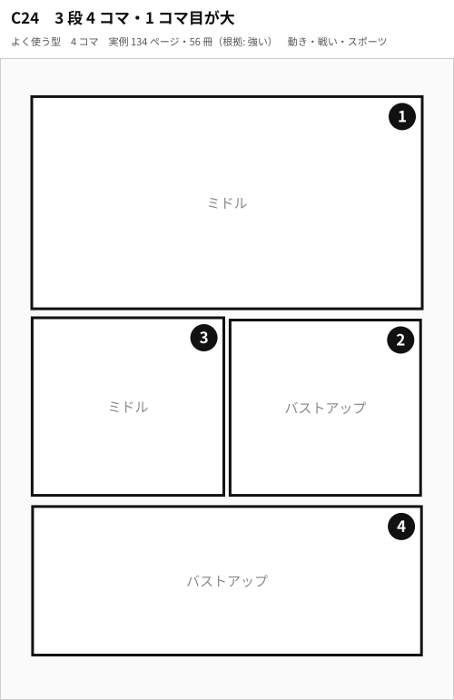

# C24 3 段 4 コマ・1 コマ目が大



- 種類: よく使う型、4 コマ
- 根拠: 実例 134 ページ・56 冊（強さ: 強い、全ページの 0.9%、最多の 1 冊が占める割合 6%）
- 向く場面: 動き・戦い・スポーツ（目的から）

## 目的

めくった先で上から大きく始め、中段 2 コマ、下の帯（台詞が多い）で締める。

## 実際の漫画での使われ方

- 右ページ（めくった先）で多い（63%）
- 1 ページの台詞は平均 6.9（全体 7.7）

## コマごとの中身（読む順）

1. **ミドル**（`medium`）: 腰から上がいちばん多い（31%）
2. **バストアップ**（`bust`）: 胸から上が全体より多い（31%、全体の 1.4 倍）
3. **ミドル**（`medium`）: 腰から上がいちばん多い（37%）
4. **バストアップ**（`bust`）: 胸から上がいちばん多い（28%）、台詞が多い（平均 2.01）

## 避けるとき

静かな感情の場面。

## ネーム TOML の雛形

```toml
[[pages]]
number = 1
# 型 C24: 3 段 4 コマ・1 コマ目が大
tiers = [0.39, 0.33, 0.28]

  [[pages.panels]]   # 1
  tier = 0
  # 役割の目安: 腰から上がいちばん多い（31%）
  # shot = "medium"   # 目安: このコマでいちばん多い shot。場面に合わせて決める
  beat = ""

  [[pages.panels]]   # 2
  tier = 1
  width = 0.50
  # 役割の目安: 胸から上が全体より多い（31%、全体の 1.4 倍）
  # shot = "bust"   # 目安: このコマで全体より多い shot（いちばん多いとは限らない）。場面に合わせて決める
  beat = ""

  [[pages.panels]]   # 3
  tier = 1
  width = 0.50
  # 役割の目安: 腰から上がいちばん多い（37%）
  # shot = "medium"   # 目安: このコマでいちばん多い shot。場面に合わせて決める
  beat = ""

  [[pages.panels]]   # 4
  tier = 2
  # 役割の目安: 胸から上がいちばん多い（28%）、台詞が多い（平均 2.01）
  # shot = "bust"   # 目安: このコマでいちばん多い shot。場面に合わせて決める
  beat = ""
```
