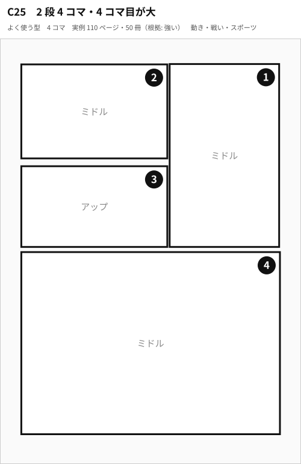

# C25 2 段 4 コマ・4 コマ目が大



- 種類: よく使う型、4 コマ
- 根拠: 実例 110 ページ・50 冊（強さ: 強い、全ページの 0.7%、最多の 1 冊が占める割合 6%）
- 向く場面: 動き・戦い・スポーツ（目的から）

## 目的

右の縦長で始め、左の 2 コマ（下は顔の寄りが多い）を挟み、下の大ゴマで全体を見せる。

## 実際の漫画での使われ方

- 1 ページの台詞は平均 6.23（全体 7.7）

## コマごとの中身（読む順）

1. **ミドル**（`medium`）: 腰から上がいちばん多い（29%）
2. **ミドル**（`medium`）: 腰から上がいちばん多い（32%）
3. **アップ**（`closeup`）: 顔の寄りが全体より多い（27%、全体の 1.8 倍）
4. **ミドル**（`medium`）: 腰から上がいちばん多い（33%）

## 避けるとき

溜めの無い会話の平場。

## ネーム TOML の雛形

```toml
[[pages]]
number = 1
# 型 C25: 2 段 4 コマ・4 コマ目が大
tiers = [0.50, 0.50]

  [[pages.panels]]   # 1
  tier = 0
  width = 0.43
  # 役割の目安: 腰から上がいちばん多い（29%）
  # shot = "medium"   # 目安: このコマでいちばん多い shot。場面に合わせて決める
  beat = ""

  [[pages.panels]]   # 2
  tier = 0
  width = 0.57
  column = 2
  height = 0.54
  # 役割の目安: 腰から上がいちばん多い（32%）
  # shot = "medium"   # 目安: このコマでいちばん多い shot。場面に合わせて決める
  beat = ""

  [[pages.panels]]   # 3
  tier = 0
  column = 2
  height = 0.46
  # 役割の目安: 顔の寄りが全体より多い（27%、全体の 1.8 倍）
  # shot = "closeup"   # 目安: このコマで全体より多い shot（いちばん多いとは限らない）。場面に合わせて決める
  beat = ""

  [[pages.panels]]   # 4
  tier = 1
  # 役割の目安: 腰から上がいちばん多い（33%）
  # shot = "medium"   # 目安: このコマでいちばん多い shot。場面に合わせて決める
  beat = ""
```
