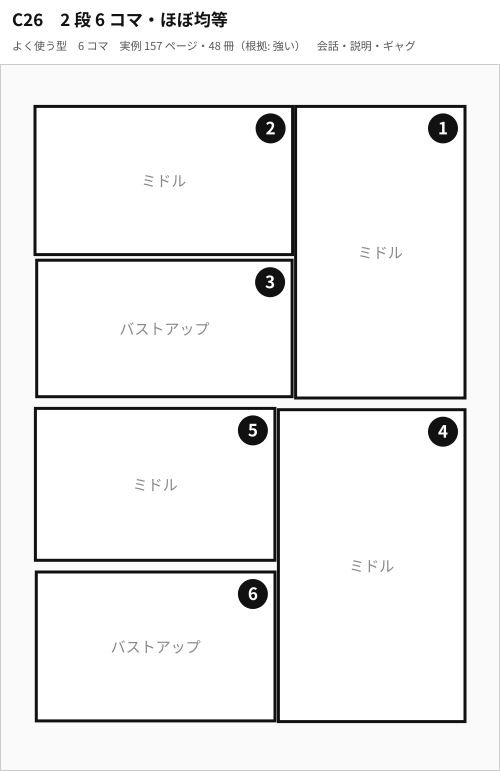

# C26 2 段 6 コマ・ほぼ均等



- 種類: よく使う型、6 コマ
- 根拠: 実例 157 ページ・48 冊（強さ: 強い、全ページの 1.0%、最多の 1 冊が占める割合 15%）
- 向く場面: 会話・説明（目的から）、ギャグ（目的から）

## 目的

縦長と小ゴマの組を 2 段。台詞の多い掛け合い。

## 実際の漫画での使われ方

- 1 ページの台詞は平均 10.85（全体 7.7）

## コマごとの中身（読む順）

1. **ミドル**（`medium`）: 腰から上がいちばん多い（36%）
2. **ミドル**（`medium`）: 腰から上がいちばん多い（33%）
3. **バストアップ**（`bust`）: 胸から上が全体より多い（29%、全体の 1.3 倍）、台詞のあることが多い（無言 11%）
4. **ミドル**（`medium`）: 腰から上がいちばん多い（34%）、台詞のあることが多い（無言 11%）、二人以上が多い（55%）
5. **ミドル**（`medium`）: 腰から上がいちばん多い（36%）、台詞のあることが多い（無言 11%）
6. **バストアップ**（`bust`）: 胸から上が全体より多い（30%、全体の 1.4 倍）、台詞のあることが多い（無言 6%）

## 避けるとき

動きの場面。

## ネーム TOML の雛形

```toml
[[pages]]
number = 1
# 型 C26: 2 段 6 コマ・ほぼ均等
tiers = [0.48, 0.52]

  [[pages.panels]]   # 1
  tier = 0
  width = 0.40
  # 役割の目安: 腰から上がいちばん多い（36%）
  # shot = "medium"   # 目安: このコマでいちばん多い shot。場面に合わせて決める
  beat = ""

  [[pages.panels]]   # 2
  tier = 0
  width = 0.60
  column = 2
  height = 0.52
  # 役割の目安: 腰から上がいちばん多い（33%）
  # shot = "medium"   # 目安: このコマでいちばん多い shot。場面に合わせて決める
  beat = ""

  [[pages.panels]]   # 3
  tier = 0
  column = 2
  height = 0.48
  # 役割の目安: 胸から上が全体より多い（29%、全体の 1.3 倍）、台詞のあることが多い（無言 11%）
  # shot = "bust"   # 目安: このコマで全体より多い shot（いちばん多いとは限らない）。場面に合わせて決める
  beat = ""

  [[pages.panels]]   # 4
  tier = 1
  width = 0.44
  # 役割の目安: 腰から上がいちばん多い（34%）、台詞のあることが多い（無言 11%）、二人以上が多い（55%）
  # shot = "medium"   # 目安: このコマでいちばん多い shot。場面に合わせて決める
  beat = ""

  [[pages.panels]]   # 5
  tier = 1
  width = 0.56
  column = 2
  height = 0.51
  # 役割の目安: 腰から上がいちばん多い（36%）、台詞のあることが多い（無言 11%）
  # shot = "medium"   # 目安: このコマでいちばん多い shot。場面に合わせて決める
  beat = ""

  [[pages.panels]]   # 6
  tier = 1
  column = 2
  height = 0.49
  # 役割の目安: 胸から上が全体より多い（30%、全体の 1.4 倍）、台詞のあることが多い（無言 6%）
  # shot = "bust"   # 目安: このコマで全体より多い shot（いちばん多いとは限らない）。場面に合わせて決める
  beat = ""
```
