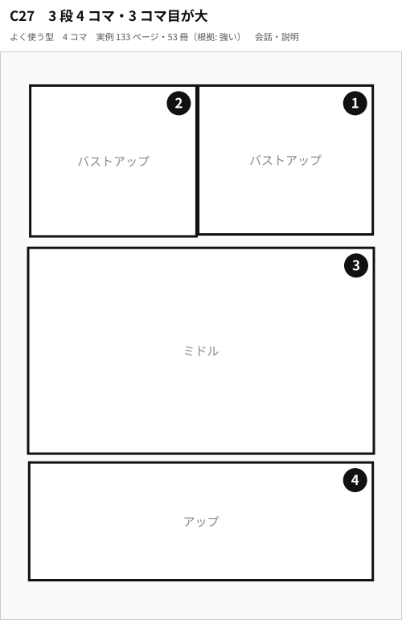

# C27 3 段 4 コマ・3 コマ目が大



- 種類: よく使う型、4 コマ
- 根拠: 実例 133 ページ・53 冊（強さ: 強い、全ページの 0.9%、最多の 1 冊が占める割合 10%）
- 向く場面: 会話・説明（目的から）

## 目的

上の 2 コマで会話、中段の大ゴマで出来事、下の帯の顔の寄りで受ける。

## 実際の漫画での使われ方

- 1 ページの台詞は平均 6.87（全体 7.7）

## コマごとの中身（読む順）

1. **バストアップ**（`bust`）: 胸から上が全体より多い（29%、全体の 1.3 倍）
2. **バストアップ**（`bust`）: 胸から上がいちばん多い（27%）
3. **ミドル**（`medium`）: 腰から上がいちばん多い（33%）、二人以上が多い（50%）、擬音が多い（平均 1.17）
4. **アップ**（`closeup`）: 顔の寄りが全体より多い（29%、全体の 1.9 倍）

## 避けるとき

恐怖・緊張の溜め（中段で開いてしまう）。

## ネーム TOML の雛形

```toml
[[pages]]
number = 1
# 型 C27: 3 段 4 コマ・3 コマ目が大
tiers = [0.32, 0.43, 0.25]

  [[pages.panels]]   # 1
  tier = 0
  width = 0.51
  # 役割の目安: 胸から上が全体より多い（29%、全体の 1.3 倍）
  # shot = "bust"   # 目安: このコマで全体より多い shot（いちばん多いとは限らない）。場面に合わせて決める
  beat = ""

  [[pages.panels]]   # 2
  tier = 0
  width = 0.49
  # 役割の目安: 胸から上がいちばん多い（27%）
  # shot = "bust"   # 目安: このコマでいちばん多い shot。場面に合わせて決める
  beat = ""

  [[pages.panels]]   # 3
  tier = 1
  # 役割の目安: 腰から上がいちばん多い（33%）、二人以上が多い（50%）、擬音が多い（平均 1.17）
  # shot = "medium"   # 目安: このコマでいちばん多い shot。場面に合わせて決める
  beat = ""

  [[pages.panels]]   # 4
  tier = 2
  # 役割の目安: 顔の寄りが全体より多い（29%、全体の 1.9 倍）
  # shot = "closeup"   # 目安: このコマで全体より多い shot（いちばん多いとは限らない）。場面に合わせて決める
  beat = ""
```
