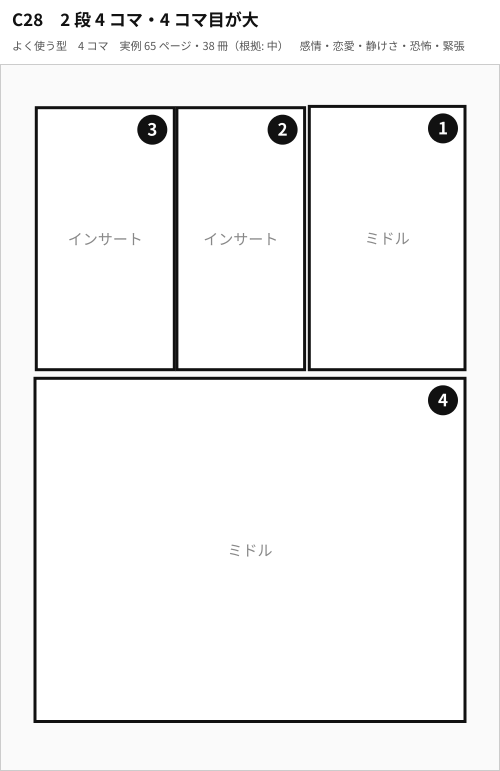

# C28 2 段 4 コマ・4 コマ目が大



- 種類: よく使う型、4 コマ
- 根拠: 実例 65 ページ・38 冊（強さ: 中、全ページの 0.4%、最多の 1 冊が占める割合 22%）
- 向く場面: 感情・恋愛・静けさ（観測・少数の作品）、恐怖・緊張（観測・少数の作品）

## 目的

上の 3 コマは無言が多く（3〜4 割）、特に 2・3 コマ目は一人か人物なし（手元・物）の小さな絵が多い。それを並べて溜め、下の大ゴマで見せる。

## 実際の漫画での使われ方

- 感情・恋愛・静けさの場面でやや多い（1.7 倍、ただし 7 冊だけ）
- 恐怖・緊張の場面でやや多い（1.4 倍、ただし 7 冊だけ）
- 少女漫画で多い（2.1 倍、32 ページ・12 冊）
- 1 ページの台詞は平均 4.92（全体 7.7）

## コマごとの中身（読む順）

1. **ミドル**（`medium`）: 腰から上が全体より多い（42%、全体の 1.4 倍）、無言が全体より多い（32%、全体 23%）
2. **インサート**（`insert`）: 人物なし（物・景色・手元）が全体より多い（26%、全体の 1.4 倍）、無言が全体より多い（40%、全体 23%）、一人が多い（62%）
3. **インサート**（`insert`）: 人物なし（物・景色・手元）が全体より多い（26%、全体の 1.4 倍）、無言が全体より多い（42%、全体 23%）、一人が多い（63%）
4. **ミドル**（`medium`）: 腰から上が全体より多い（46%、全体の 1.5 倍）

## 避けるとき

説明の多い会話（上の 3 コマは無言が多く、台詞が入りにくい）。

## ネーム TOML の雛形

```toml
[[pages]]
number = 1
# 型 C28: 2 段 4 コマ・4 コマ目が大
tiers = [0.43, 0.57]

  [[pages.panels]]   # 1
  tier = 0
  width = 0.37
  # 役割の目安: 腰から上が全体より多い（42%、全体の 1.4 倍）、無言が全体より多い（32%、全体 23%）
  # shot = "medium"   # 目安: このコマで全体より多い shot（いちばん多いとは限らない）。場面に合わせて決める
  beat = ""

  [[pages.panels]]   # 2
  tier = 0
  width = 0.30
  # 役割の目安: 人物なし（物・景色・手元）が全体より多い（26%、全体の 1.4 倍）、無言が全体より多い（40%、全体 23%）、一人が多い（62%）
  # shot = "insert"   # 目安: このコマで全体より多い shot（いちばん多いとは限らない）。場面に合わせて決める
  beat = ""

  [[pages.panels]]   # 3
  tier = 0
  width = 0.33
  # 役割の目安: 人物なし（物・景色・手元）が全体より多い（26%、全体の 1.4 倍）、無言が全体より多い（42%、全体 23%）、一人が多い（63%）
  # shot = "insert"   # 目安: このコマで全体より多い shot（いちばん多いとは限らない）。場面に合わせて決める
  beat = ""

  [[pages.panels]]   # 4
  tier = 1
  # 役割の目安: 腰から上が全体より多い（46%、全体の 1.5 倍）
  # shot = "medium"   # 目安: このコマで全体より多い shot（いちばん多いとは限らない）。場面に合わせて決める
  beat = ""
```
