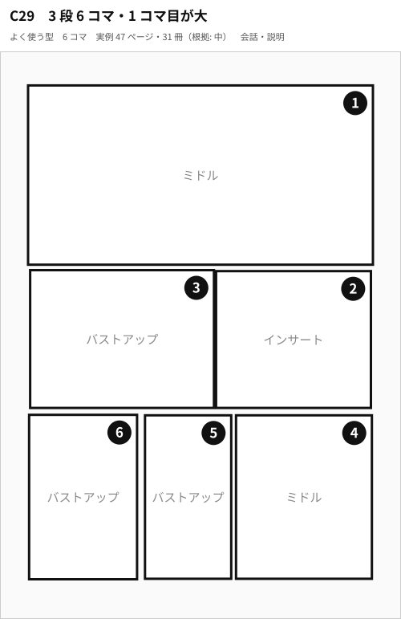

# C29 3 段 6 コマ・1 コマ目が大



- 種類: よく使う型、6 コマ
- 根拠: 実例 47 ページ・31 冊（強さ: 中、全ページの 0.3%、最多の 1 冊が占める割合 11%）
- 向く場面: 会話・説明（観測）

## 目的

上の大ゴマで場面を開き、中段 2 → 下 3 と細かくして会話へ入る。

## 実際の漫画での使われ方

- 会話・説明の場面で多い（1.4 倍、11 冊）
- 1 ページの台詞は平均 9.45（全体 7.7）

## コマごとの中身（読む順）

1. **ミドル**（`medium`）: 腰から上がいちばん多い（32%）、二人以上が多い（55%）
2. **インサート**（`insert`）: 人物なし（物・景色・手元）が全体より多い（26%、全体の 1.4 倍）、無言が全体より多い（32%、全体 23%）
3. **バストアップ**（`bust`）: 胸から上が全体より多い（38%、全体の 1.7 倍）、台詞のあることが多い（無言 9%）
4. **ミドル**（`medium`）: 腰から上が全体より多い（45%、全体の 1.5 倍）、台詞のあることが多い（無言 6%）
5. **バストアップ**（`bust`）: 胸から上が全体より多い（32%、全体の 1.4 倍）
6. **バストアップ**（`bust`）: 胸から上が全体より多い（38%、全体の 1.7 倍）、台詞のあることが多い（無言 6%）、一人が多い（62%）

## 避けるとき

山場（大ゴマが冒頭にあり、後は小さくなる一方）。

## ネーム TOML の雛形

```toml
[[pages]]
number = 1
# 型 C29: 3 段 6 コマ・1 コマ目が大
tiers = [0.37, 0.29, 0.34]

  [[pages.panels]]   # 1
  tier = 0
  # 役割の目安: 腰から上がいちばん多い（32%）、二人以上が多い（55%）
  # shot = "medium"   # 目安: このコマでいちばん多い shot。場面に合わせて決める
  beat = ""

  [[pages.panels]]   # 2
  tier = 1
  width = 0.46
  # 役割の目安: 人物なし（物・景色・手元）が全体より多い（26%、全体の 1.4 倍）、無言が全体より多い（32%、全体 23%）
  # shot = "insert"   # 目安: このコマで全体より多い shot（いちばん多いとは限らない）。場面に合わせて決める
  beat = ""

  [[pages.panels]]   # 3
  tier = 1
  width = 0.54
  # 役割の目安: 胸から上が全体より多い（38%、全体の 1.7 倍）、台詞のあることが多い（無言 9%）
  # shot = "bust"   # 目安: このコマで全体より多い shot（いちばん多いとは限らない）。場面に合わせて決める
  beat = ""

  [[pages.panels]]   # 4
  tier = 2
  width = 0.41
  # 役割の目安: 腰から上が全体より多い（45%、全体の 1.5 倍）、台詞のあることが多い（無言 6%）
  # shot = "medium"   # 目安: このコマで全体より多い shot（いちばん多いとは限らない）。場面に合わせて決める
  beat = ""

  [[pages.panels]]   # 5
  tier = 2
  width = 0.26
  # 役割の目安: 胸から上が全体より多い（32%、全体の 1.4 倍）
  # shot = "bust"   # 目安: このコマで全体より多い shot（いちばん多いとは限らない）。場面に合わせて決める
  beat = ""

  [[pages.panels]]   # 6
  tier = 2
  width = 0.33
  # 役割の目安: 胸から上が全体より多い（38%、全体の 1.7 倍）、台詞のあることが多い（無言 6%）、一人が多い（62%）
  # shot = "bust"   # 目安: このコマで全体より多い shot（いちばん多いとは限らない）。場面に合わせて決める
  beat = ""
```
