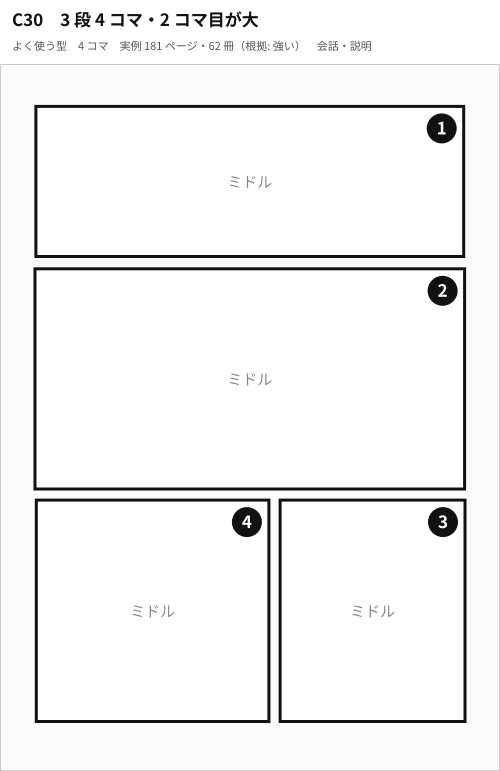

# C30 3 段 4 コマ・2 コマ目が大



- 種類: よく使う型、4 コマ
- 根拠: 実例 181 ページ・62 冊（強さ: 強い、全ページの 1.2%、最多の 1 冊が占める割合 14%）
- 向く場面: 会話・説明（目的から）

## 目的

上の帯で振り、中段の大ゴマで見せ、下の 2 コマで受ける。4 コマとも腰から上が中心。

## 実際の漫画での使われ方

- 女性漫画で多い（2.0 倍、48 ページ・9 冊）
- 1 ページの台詞は平均 7（全体 7.7）

## コマごとの中身（読む順）

1. **ミドル**（`medium`）: 腰から上がいちばん多い（25%）
2. **ミドル**（`medium`）: 腰から上がいちばん多い（33%）
3. **ミドル**（`medium`）: 腰から上がいちばん多い（35%）
4. **ミドル**（`medium`）: 腰から上がいちばん多い（29%）

## 避けるとき

感情を言葉少なく見せたいとき（台詞が多めの型）。

## ネーム TOML の雛形

```toml
[[pages]]
number = 1
# 型 C30: 3 段 4 コマ・2 コマ目が大
tiers = [0.25, 0.37, 0.37]

  [[pages.panels]]   # 1
  tier = 0
  # 役割の目安: 腰から上がいちばん多い（25%）
  # shot = "medium"   # 目安: このコマでいちばん多い shot。場面に合わせて決める
  beat = ""

  [[pages.panels]]   # 2
  tier = 1
  # 役割の目安: 腰から上がいちばん多い（33%）
  # shot = "medium"   # 目安: このコマでいちばん多い shot。場面に合わせて決める
  beat = ""

  [[pages.panels]]   # 3
  tier = 2
  width = 0.44
  # 役割の目安: 腰から上がいちばん多い（35%）
  # shot = "medium"   # 目安: このコマでいちばん多い shot。場面に合わせて決める
  beat = ""

  [[pages.panels]]   # 4
  tier = 2
  width = 0.56
  # 役割の目安: 腰から上がいちばん多い（29%）
  # shot = "medium"   # 目安: このコマでいちばん多い shot。場面に合わせて決める
  beat = ""
```
