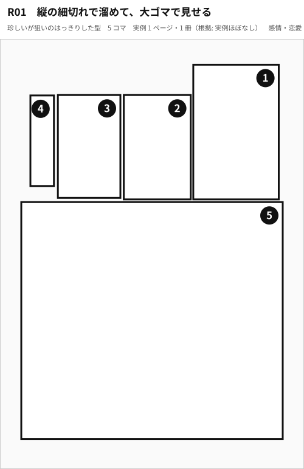

# R01 縦の細切れで溜めて、大ゴマで見せる



- 種類: 珍しいが狙いのはっきりした型、5 コマ
- 根拠: 実例 1 ページ・1 冊（強さ: 実例ほぼなし、全ページの 0.0%、最多の 1 冊が占める割合 100%）
- 向く場面: 感情・恋愛・静けさ（構図から）、動き・戦い・スポーツ（構図から）

## 目的

上段を細い縦ゴマ 4 つに刻み、右から左へ幅を狭めて時間を詰める。下の大ゴマで一気に開く。告白の直前、振り向く瞬間、技が決まる直前に。

## 避けるとき

会話の多いページ。細い縦ゴマに吹き出しは入らない。

## ネーム TOML の雛形

```toml
[[pages]]
number = 1
# 型 R01: 縦の細切れで溜めて、大ゴマで見せる
# bbox で組む型（重なり・はめ込み・段からずれた位置）。order = "written" で、書いた順を読む順として書き出しまで保つ
order = "written"

  [[pages.panels]]   # 1
  bbox = [636, 60, 917, 373]
  beat = ""

  [[pages.panels]]   # 2
  bbox = [407, 130, 627, 373]
  beat = ""

  [[pages.panels]]   # 3
  bbox = [190, 130, 396, 370]
  beat = ""

  [[pages.panels]]   # 4
  bbox = [100, 131, 178, 342]
  beat = ""

  [[pages.panels]]   # 5
  bbox = [70, 379, 930, 930]
  beat = ""
```
