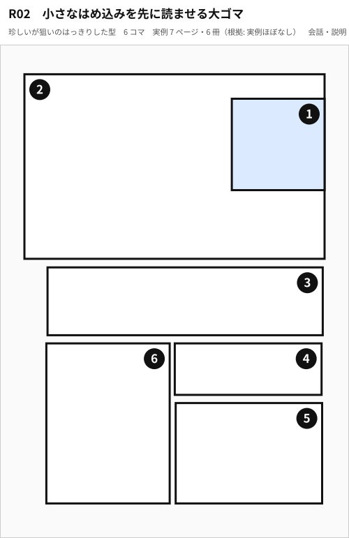

# R02 小さなはめ込みを先に読ませる大ゴマ



- 種類: 珍しいが狙いのはっきりした型、6 コマ
- 根拠: 実例 7 ページ・6 冊（強さ: 実例ほぼなし、全ページの 0.1%、最多の 1 冊が占める割合 29%）
- 向く場面: 会話・説明（構図から）、恐怖・緊張（構図から）

## 目的

大ゴマの右上に小さなコマを重ねて先に読ませる（声・音・視線の先）。そのあと大ゴマ全体が見える。下の段は小さく割って会話に戻る。

## 避けるとき

はめ込みの中身が大ゴマと無関係なとき。はめ込みは大ゴマの一部の寄りか、そこに届く声・音に。

## ネーム TOML の雛形

```toml
[[pages]]
number = 1
# 型 R02: 小さなはめ込みを先に読ませる大ゴマ
# bbox で組む型（重なり・はめ込み・段からずれた位置）。order = "written" で、書いた順を読む順として書き出しまで保つ
order = "written"

  [[pages.panels]]   # 1
  bbox = [664, 110, 930, 295]
  inset = true      # 重ねる（はめ込み・枠越え）
  beat = ""

  [[pages.panels]]   # 2
  bbox = [70, 60, 930, 434]
  beat = ""

  [[pages.panels]]   # 3
  bbox = [136, 452, 925, 589]
  beat = ""

  [[pages.panels]]   # 4
  bbox = [501, 605, 921, 710]
  beat = ""

  [[pages.panels]]   # 5
  bbox = [503, 726, 923, 930]
  beat = ""

  [[pages.panels]]   # 6
  bbox = [133, 605, 486, 930]
  beat = ""
```
