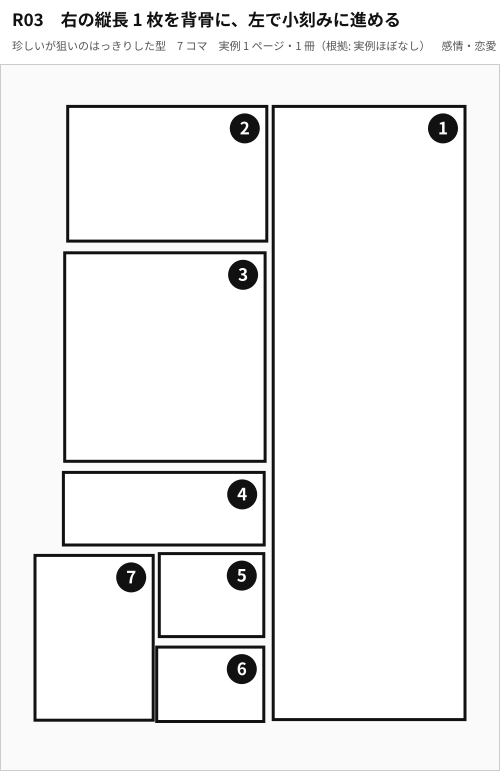

# R03 右の縦長 1 枚を背骨に、左で小刻みに進める



- 種類: 珍しいが狙いのはっきりした型、7 コマ
- 根拠: 実例 1 ページ・1 冊（強さ: 実例ほぼなし、全ページの 0.0%、最多の 1 冊が占める割合 100%）
- 向く場面: 感情・恋愛・静けさ（構図から）

## 目的

ページの右端を上から下まで 1 コマにして、立ち姿・落下・見上げる高さを見せる。左の小ゴマで、その間の表情や反応を順に読ませる。縦長のコマは最初に読まれ、ページの最後まで視界に残る。

## 避けるとき

縦に意味の無い構図（座って話すだけ）。縦長は高さ・長さを見せるときだけ。

## ネーム TOML の雛形

```toml
[[pages]]
number = 1
# 型 R03: 右の縦長 1 枚を背骨に、左で小刻みに進める
# bbox で組む型（重なり・はめ込み・段からずれた位置）。order = "written" で、書いた順を読む順として書き出しまで保つ
order = "written"

  [[pages.panels]]   # 1
  bbox = [546, 60, 930, 927]
  beat = ""

  [[pages.panels]]   # 2
  bbox = [135, 60, 534, 251]
  beat = ""

  [[pages.panels]]   # 3
  bbox = [129, 267, 530, 562]
  beat = ""

  [[pages.panels]]   # 4
  bbox = [127, 578, 528, 680]
  beat = ""

  [[pages.panels]]   # 5
  bbox = [319, 692, 528, 810]
  beat = ""

  [[pages.panels]]   # 6
  bbox = [313, 825, 528, 930]
  beat = ""

  [[pages.panels]]   # 7
  bbox = [70, 695, 306, 928]
  beat = ""
```
