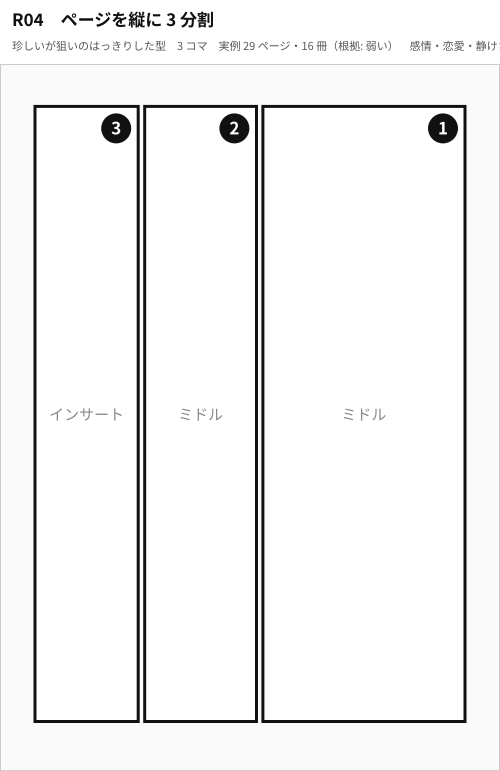

# R04 ページを縦に 3 分割



- 種類: 珍しいが狙いのはっきりした型、3 コマ
- 根拠: 実例 29 ページ・16 冊（強さ: 弱い、全ページの 0.2%、最多の 1 冊が占める割合 17%）
- 向く場面: 感情・恋愛・静けさ（構図から）

## 目的

ページを縦に 3 分割。右の 1 本は一人が多く、最後の 1 本は物や景色（人物なし 38%）と無言が多い。横の段が無いので時間が止まって見える。静かな場面、別れ、決意に。

## 実際の漫画での使われ方

- 単行本の終わり 1 割で多い（17%、全体 8%）
- 女性漫画で多い（2.8 倍、11 ページ・4 冊）
- 1 ページの台詞は平均 4.24（全体 7.7）

## コマごとの中身（読む順）

1. **ミドル**（`medium`）: 腰から上がいちばん多い（34%）、一人が多い（72%）
2. **ミドル**（`medium`）: 腰から上がいちばん多い（38%）、無言が全体より多い（31%、全体 23%）
3. **インサート**（`insert`）: 人物なし（物・景色・手元）が全体より多い（38%、全体の 2.1 倍）、無言が全体より多い（41%、全体 23%）

## 避けるとき

台詞の多い場面。3 本とも細く、吹き出しは 1 本に 1 個まで。

## ネーム TOML の雛形

```toml
[[pages]]
number = 1
# 型 R04: ページを縦に 3 分割
tiers = [1.00]

  [[pages.panels]]   # 1
  tier = 0
  width = 0.48
  # 役割の目安: 腰から上がいちばん多い（34%）、一人が多い（72%）
  # shot = "medium"   # 目安: このコマでいちばん多い shot。場面に合わせて決める
  beat = ""

  [[pages.panels]]   # 2
  tier = 0
  width = 0.27
  # 役割の目安: 腰から上がいちばん多い（38%）、無言が全体より多い（31%、全体 23%）
  # shot = "medium"   # 目安: このコマでいちばん多い shot。場面に合わせて決める
  beat = ""

  [[pages.panels]]   # 3
  tier = 0
  width = 0.25
  # 役割の目安: 人物なし（物・景色・手元）が全体より多い（38%、全体の 2.1 倍）、無言が全体より多い（41%、全体 23%）
  # shot = "insert"   # 目安: このコマで全体より多い shot（いちばん多いとは限らない）。場面に合わせて決める
  beat = ""
```
