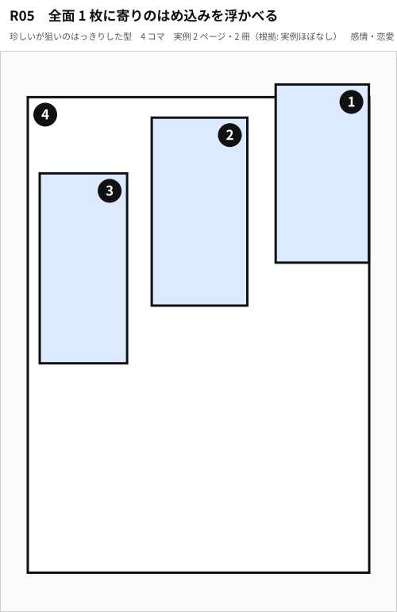

# R05 全面 1 枚に寄りのはめ込みを浮かべる



- 種類: 珍しいが狙いのはっきりした型、4 コマ
- 根拠: 実例 2 ページ・2 冊（強さ: 実例ほぼなし、全ページの 0.0%、最多の 1 冊が占める割合 50%）
- 向く場面: 感情・恋愛・静けさ（構図から）

## 目的

全面の大ゴマ（場所・全身・情景）の上に、顔や手の寄りを 2〜3 個はめ込む。読者は寄りを読んでから最後に全体を見る。感情が広がる瞬間、再会、景色に圧倒される場面に。

## 避けるとき

はめ込みが 4 個以上。全体の大ゴマが見えなくなる。

## ネーム TOML の雛形

```toml
[[pages]]
number = 1
# 型 R05: 全面 1 枚に寄りのはめ込みを浮かべる
# bbox で組む型（重なり・はめ込み・段からずれた位置）。order = "written" で、書いた順を読む順として書き出しまで保つ
order = "written"

  [[pages.panels]]   # 1
  bbox = [694, 60, 929, 378]
  inset = true      # 重ねる（はめ込み・枠越え）
  beat = ""

  [[pages.panels]]   # 2
  bbox = [382, 119, 623, 454]
  inset = true      # 重ねる（はめ込み・枠越え）
  beat = ""

  [[pages.panels]]   # 3
  bbox = [100, 218, 320, 557]
  inset = true      # 重ねる（はめ込み・枠越え）
  beat = ""

  [[pages.panels]]   # 4
  bbox = [70, 83, 930, 930]
  beat = ""
```
