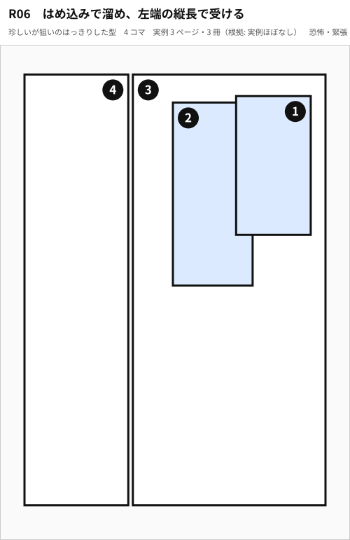

# R06 はめ込みで溜め、左端の縦長で受ける



- 種類: 珍しいが狙いのはっきりした型、4 コマ
- 根拠: 実例 3 ページ・3 冊（強さ: 実例ほぼなし、全ページの 0.0%、最多の 1 冊が占める割合 33%）
- 向く場面: 恐怖・緊張（構図から）

## 目的

右の大ゴマに寄りを 2 つはめ込んで緊張を溜め、左端の縦長で受ける。縦長は最後に読まれ、そのまま次のページへの引きになる。

## 避けるとき

緊張の無い場面。はめ込みの寄りが効かない。

## ネーム TOML の雛形

```toml
[[pages]]
number = 1
# 型 R06: はめ込みで溜め、左端の縦長で受ける
# bbox で組む型（重なり・はめ込み・段からずれた位置）。order = "written" で、書いた順を読む順として書き出しまで保つ
order = "written"

  [[pages.panels]]   # 1
  bbox = [675, 104, 888, 384]
  inset = true      # 重ねる（はめ込み・枠越え）
  beat = ""

  [[pages.panels]]   # 2
  bbox = [494, 117, 722, 486]
  inset = true      # 重ねる（はめ込み・枠越え）
  beat = ""

  [[pages.panels]]   # 3
  bbox = [380, 60, 930, 930]
  beat = ""

  [[pages.panels]]   # 4
  bbox = [70, 60, 367, 930]
  beat = ""
```
