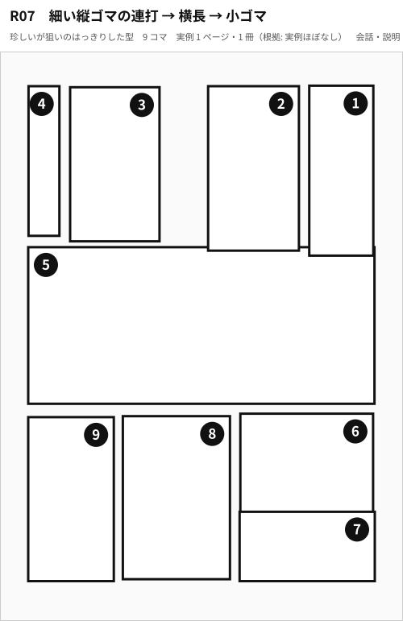

# R07 細い縦ゴマの連打 → 横長 → 小ゴマ



- 種類: 珍しいが狙いのはっきりした型、9 コマ
- 根拠: 実例 1 ページ・1 冊（強さ: 実例ほぼなし、全ページの 0.0%、最多の 1 冊が占める割合 100%）
- 向く場面: 会話・説明（構図から）、ギャグ（構図から）

## 目的

上段の縦ゴマで短い動作や台詞を刻み、中段の横長で全体を見せ、下段で反応を並べる。会話のテンポを上げたいページに。

## 避けるとき

感情の山場。9 コマはどれも小さい。

## ネーム TOML の雛形

```toml
[[pages]]
number = 1
# 型 R07: 細い縦ゴマの連打 → 横長 → 小ゴマ
# bbox で組む型（重なり・はめ込み・段からずれた位置）。order = "written" で、書いた順を読む順として書き出しまで保つ
order = "written"

  [[pages.panels]]   # 1
  bbox = [767, 60, 927, 358]
  beat = ""

  [[pages.panels]]   # 2
  bbox = [516, 61, 742, 350]
  beat = ""

  [[pages.panels]]   # 3
  bbox = [174, 63, 396, 333]
  beat = ""

  [[pages.panels]]   # 4
  bbox = [71, 61, 147, 324]
  beat = ""

  [[pages.panels]]   # 5
  bbox = [70, 344, 929, 619]
  beat = ""

  [[pages.panels]]   # 6
  bbox = [596, 636, 926, 810]
  beat = ""

  [[pages.panels]]   # 7
  bbox = [595, 808, 930, 930]
  beat = ""

  [[pages.panels]]   # 8
  bbox = [305, 640, 571, 927]
  beat = ""

  [[pages.panels]]   # 9
  bbox = [70, 642, 282, 930]
  beat = ""
```
