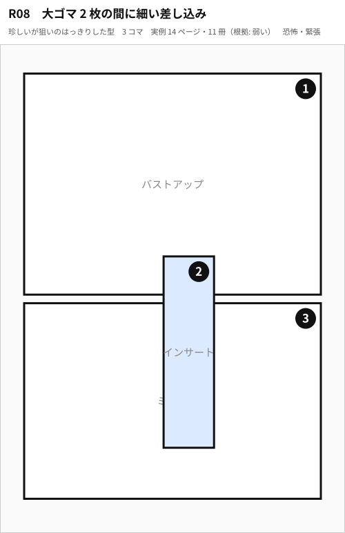

# R08 大ゴマ 2 枚の間に細い差し込み



- 種類: 珍しいが狙いのはっきりした型、3 コマ
- 根拠: 実例 14 ページ・11 冊（強さ: 弱い、全ページの 0.1%、最多の 1 冊が占める割合 21%）
- 向く場面: 恐怖・緊張（構図から）

## 目的

上下の大ゴマのあいだに細い縦のコマを差し込む（目、手、時計）。大きな出来事と出来事の間の一瞬を挟む。

## 実際の漫画での使われ方

- 少女漫画で多い（2.5 倍、8 ページ・5 冊）
- 1 ページの台詞は平均 5.64（全体 7.7）

## コマごとの中身（読む順）

1. **バストアップ**（`bust`）: 胸から上が全体より多い（36%、全体の 1.6 倍）
2. **インサート**（`insert`）: 人物なし（物・景色・手元）が全体より多い（43%、全体の 2.4 倍）、無言が全体より多い（43%、全体 23%）、二人以上は少ない（7%）
3. **ミドル**（`medium`）: 腰から上がいちばん多い（29%）、台詞が多い（平均 2.36）、二人以上が多い（57%）

## 避けるとき

差し込む一瞬が無いとき。細いコマは目・手・時計など一点の寄りに限る。

## ネーム TOML の雛形

```toml
[[pages]]
number = 1
# 型 R08: 大ゴマ 2 枚の間に細い差し込み
# bbox で組む型（重なり・はめ込み・段からずれた位置）。order = "written" で、書いた順を読む順として書き出しまで保つ
order = "written"

  [[pages.panels]]   # 1
  bbox = [70, 60, 930, 512]
  # 役割の目安: 胸から上が全体より多い（36%、全体の 1.6 倍）
  # shot = "bust"   # 目安: このコマで全体より多い shot（いちばん多いとは限らない）。場面に合わせて決める
  beat = ""

  [[pages.panels]]   # 2
  bbox = [474, 434, 620, 826]
  inset = true      # 重ねる（はめ込み・枠越え）
  # 役割の目安: 人物なし（物・景色・手元）が全体より多い（43%、全体の 2.4 倍）、無言が全体より多い（43%、全体 23%）、二人以上は少ない（7%）
  # shot = "insert"   # 目安: このコマで全体より多い shot（いちばん多いとは限らない）。場面に合わせて決める
  beat = ""

  [[pages.panels]]   # 3
  bbox = [70, 530, 930, 930]
  # 役割の目安: 腰から上がいちばん多い（29%）、台詞が多い（平均 2.36）、二人以上が多い（57%）
  # shot = "medium"   # 目安: このコマでいちばん多い shot。場面に合わせて決める
  beat = ""
```
