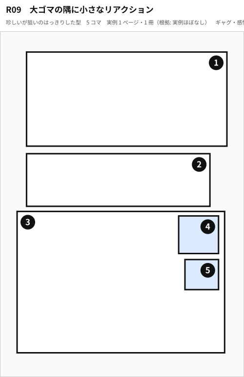

# R09 大ゴマの隅に小さなリアクション



- 種類: 珍しいが狙いのはっきりした型、5 コマ
- 根拠: 実例 1 ページ・1 冊（強さ: 実例ほぼなし、全ページの 0.0%、最多の 1 冊が占める割合 100%）
- 向く場面: ギャグ（構図から）、感情・恋愛・静けさ（構図から）

## 目的

最後の大ゴマの隅に、豆粒のようなコマを 1〜2 個はめ込む（小さなツッコミ、心の声、汗をかく脇役）。大ゴマの余韻を壊さずに笑いや本音を足す。

## 避けるとき

大ゴマが深刻な場面（ツッコミが余韻を壊す）。本音を足すなら心の声に。

## ネーム TOML の雛形

```toml
[[pages]]
number = 1
# 型 R09: 大ゴマの隅に小さなリアクション
# bbox で組む型（重なり・はめ込み・段からずれた位置）。order = "written" で、書いた順を読む順として書き出しまで保つ
order = "written"

  [[pages.panels]]   # 1
  bbox = [109, 60, 930, 332]
  beat = ""

  [[pages.panels]]   # 2
  bbox = [109, 354, 860, 506]
  beat = ""

  [[pages.panels]]   # 3
  bbox = [70, 521, 921, 930]
  beat = ""

  [[pages.panels]]   # 4
  bbox = [732, 534, 896, 643]
  inset = true      # 重ねる（はめ込み・枠越え）
  beat = ""

  [[pages.panels]]   # 5
  bbox = [758, 660, 896, 747]
  inset = true      # 重ねる（はめ込み・枠越え）
  beat = ""
```
