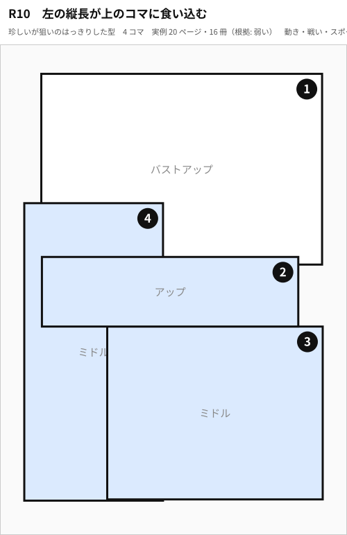

# R10 左の縦長が上のコマに食い込む



- 種類: 珍しいが狙いのはっきりした型、4 コマ
- 根拠: 実例 20 ページ・16 冊（強さ: 弱い、全ページの 0.1%、最多の 1 冊が占める割合 10%）
- 向く場面: 動き・戦い・スポーツ（構図から）、会話・説明（構図から）

## 目的

上の横長 2 つ（2 つ目は無言の顔の寄りが多い）と右下のコマを読ませたあと、左の縦長（腰から上が多い）が上のコマに食い込んで重なる。人物が枠を越えて前に出てくる。登場、決め台詞に。

## 実際の漫画での使われ方

- 右ページ（めくった先）で多い（65%）
- 1 ページの台詞は平均 6.85（全体 7.7）

## コマごとの中身（読む順）

1. **バストアップ**（`bust`）: 胸から上が全体より多い（35%、全体の 1.6 倍）、台詞が多い（平均 2.05）、二人以上が多い（50%）
2. **アップ**（`closeup`）: 顔の寄りが全体より多い（35%、全体の 2.3 倍）、無言が全体より多い（35%、全体 23%）
3. **ミドル**（`medium`）: 腰から上がいちばん多い（35%）、台詞が多い（平均 2.05）
4. **ミドル**（`medium`）: 腰から上が全体より多い（40%、全体の 1.3 倍）

## 避けるとき

人物が前に出る理由が無いとき。食い込みは登場・決めの一度だけ。

## ネーム TOML の雛形

```toml
[[pages]]
number = 1
# 型 R10: 左の縦長が上のコマに食い込む
# bbox で組む型（重なり・はめ込み・段からずれた位置）。order = "written" で、書いた順を読む順として書き出しまで保つ
order = "written"

  [[pages.panels]]   # 1
  bbox = [119, 60, 928, 449]
  # 役割の目安: 胸から上が全体より多い（35%、全体の 1.6 倍）、台詞が多い（平均 2.05）、二人以上が多い（50%）
  # shot = "bust"   # 目安: このコマで全体より多い shot（いちばん多いとは限らない）。場面に合わせて決める
  beat = ""

  [[pages.panels]]   # 2
  bbox = [121, 433, 859, 575]
  inset = true      # 重ねる（はめ込み・枠越え）
  # 役割の目安: 顔の寄りが全体より多い（35%、全体の 2.3 倍）、無言が全体より多い（35%、全体 23%）
  # shot = "closeup"   # 目安: このコマで全体より多い shot（いちばん多いとは限らない）。場面に合わせて決める
  beat = ""

  [[pages.panels]]   # 3
  bbox = [309, 575, 930, 927]
  inset = true      # 重ねる（はめ込み・枠越え）
  # 役割の目安: 腰から上がいちばん多い（35%）、台詞が多い（平均 2.05）
  # shot = "medium"   # 目安: このコマでいちばん多い shot。場面に合わせて決める
  beat = ""

  [[pages.panels]]   # 4
  bbox = [70, 324, 470, 930]
  inset = true      # 重ねる（はめ込み・枠越え）
  # 役割の目安: 腰から上が全体より多い（40%、全体の 1.3 倍）
  # shot = "medium"   # 目安: このコマで全体より多い shot（いちばん多いとは限らない）。場面に合わせて決める
  beat = ""
```
