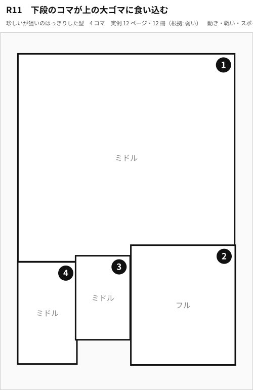

# R11 下段のコマが上の大ゴマに食い込む



- 種類: 珍しいが狙いのはっきりした型、4 コマ
- 根拠: 実例 12 ページ・12 冊（強さ: 弱い、全ページの 0.1%、最多の 1 冊が占める割合 8%）
- 向く場面: 動き・戦い・スポーツ（構図から）、恐怖・緊張（構図から）

## 目的

大ゴマのあと、下段の右のコマ（次に読む）が上の大ゴマに少し食い込む。出来事の勢いが次のコマへ続く。ぶつかる瞬間、振り向きに。

## 実際の漫画での使われ方

- 女性漫画でやや多い（1.9 倍、ただし 3 ページ・3 冊だけ）
- 1 ページの台詞は平均 6.25（全体 7.7）

## コマごとの中身（読む順）

1. **ミドル**（`medium`）: 腰から上が全体より多い（67%、全体の 2.2 倍）、無言が全体より多い（33%、全体 23%）、二人以上が多い（58%）
2. **フル**（`full`）: 全身が全体より多い（25%、全体の 3.0 倍）
3. **ミドル**（`medium`）: 腰から上がいちばん多い（33%）、台詞のあることが多い（無言 8%）
4. **ミドル**（`medium`）: 腰から上が全体より多い（50%、全体の 1.6 倍）

## 避けるとき

静かな場面。食い込みは勢いを作る。

## ネーム TOML の雛形

```toml
[[pages]]
number = 1
# 型 R11: 下段のコマが上の大ゴマに食い込む
# bbox で組む型（重なり・はめ込み・段からずれた位置）。order = "written" で、書いた順を読む順として書き出しまで保つ
order = "written"

  [[pages.panels]]   # 1
  bbox = [71, 60, 927, 641]
  # 役割の目安: 腰から上が全体より多い（67%、全体の 2.2 倍）、無言が全体より多い（33%、全体 23%）、二人以上が多い（58%）
  # shot = "medium"   # 目安: このコマで全体より多い shot（いちばん多いとは限らない）。場面に合わせて決める
  beat = ""

  [[pages.panels]]   # 2
  bbox = [517, 595, 930, 930]
  # 役割の目安: 全身が全体より多い（25%、全体の 3.0 倍）
  # shot = "full"   # 目安: このコマで全体より多い shot（いちばん多いとは限らない）。場面に合わせて決める
  beat = ""

  [[pages.panels]]   # 3
  bbox = [299, 625, 515, 860]
  # 役割の目安: 腰から上がいちばん多い（33%）、台詞のあることが多い（無言 8%）
  # shot = "medium"   # 目安: このコマでいちばん多い shot。場面に合わせて決める
  beat = ""

  [[pages.panels]]   # 4
  bbox = [70, 642, 304, 927]
  # 役割の目安: 腰から上が全体より多い（50%、全体の 1.6 倍）
  # shot = "medium"   # 目安: このコマで全体より多い shot（いちばん多いとは限らない）。場面に合わせて決める
  beat = ""
```
