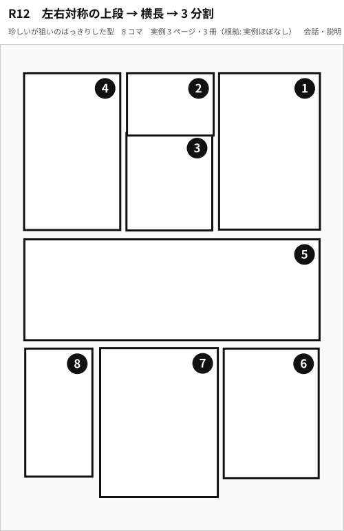

# R12 左右対称の上段 → 横長 → 3 分割



- 種類: 珍しいが狙いのはっきりした型、8 コマ
- 根拠: 実例 3 ページ・3 冊（強さ: 実例ほぼなし、全ページの 0.0%、最多の 1 冊が占める割合 33%）
- 向く場面: 会話・説明（構図から）

## 目的

上段を縦長・小 2 段・縦長の対称に組む。二人の対峙や、二人の間で起きる小さな出来事に。中段の横長で引いて位置関係を見せる。

## 避けるとき

二人の対比が無いとき。対称形は対立か対になる二人のため。

## ネーム TOML の雛形

```toml
[[pages]]
number = 1
# 型 R12: 左右対称の上段 → 横長 → 3 分割
# bbox で組む型（重なり・はめ込み・段からずれた位置）。order = "written" で、書いた順を読む順として書き出しまで保つ
order = "written"

  [[pages.panels]]   # 1
  bbox = [637, 60, 930, 381]
  beat = ""

  [[pages.panels]]   # 2
  bbox = [369, 60, 621, 188]
  beat = ""

  [[pages.panels]]   # 3
  bbox = [368, 183, 617, 383]
  beat = ""

  [[pages.panels]]   # 4
  bbox = [70, 60, 350, 382]
  beat = ""

  [[pages.panels]]   # 5
  bbox = [71, 401, 929, 608]
  beat = ""

  [[pages.panels]]   # 6
  bbox = [650, 626, 927, 892]
  beat = ""

  [[pages.panels]]   # 7
  bbox = [291, 625, 633, 930]
  beat = ""

  [[pages.panels]]   # 8
  bbox = [73, 626, 269, 888]
  beat = ""
```
