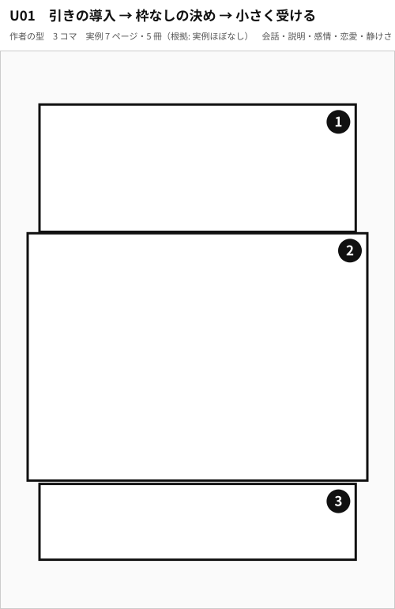

# U01 引きの導入 → 枠なしの決め → 小さく受ける



- 種類: 作者の型、3 コマ
- 根拠: 実例 7 ページ・5 冊（強さ: 実例ほぼなし、全ページの 0.1%、最多の 1 冊が占める割合 43%）
- 向く場面: 会話・説明（構図から）、感情・恋愛・静けさ（構図から）

## 目的

1 コマ目で場所と人物を小さく見せ、ナレーション箱で状況を一言。2 コマ目は枠を外した決めコマ（detail = "key"）で、人物と手元を大きく。3 コマ目は横長の小さなコマで、受けの反応を軽く（detail = "light"）。2026-11-15 の比較画像の「工夫した版」から。

## 避けるとき

会話の多いページ。3 コマで運べる台詞は少ない。

## ネーム TOML の雛形

```toml
[[pages]]
number = 1
# 型 U01: 引きの導入 → 枠なしの決め → 小さく受ける
# bbox で組む型（重なり・はめ込み・段からずれた位置）。order = "written" で、書いた順を読む順として書き出しまで保つ
order = "written"

  [[pages.panels]]   # 1
  bbox = [100, 97, 901, 324]
  beat = ""

  [[pages.panels]]   # 2
  bbox = [70, 327, 930, 770]
  beat = ""

  [[pages.panels]]   # 3
  bbox = [100, 776, 901, 912]
  beat = ""
```
